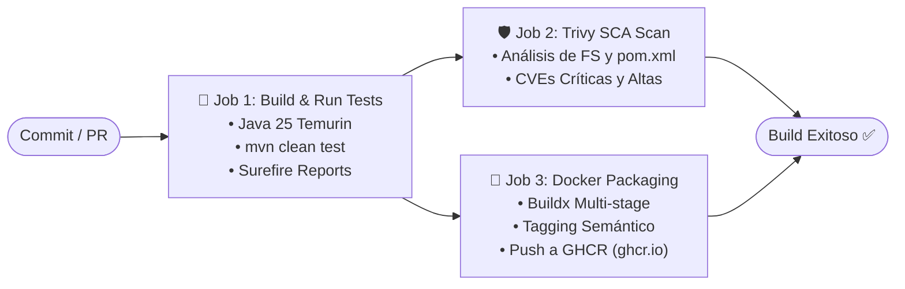
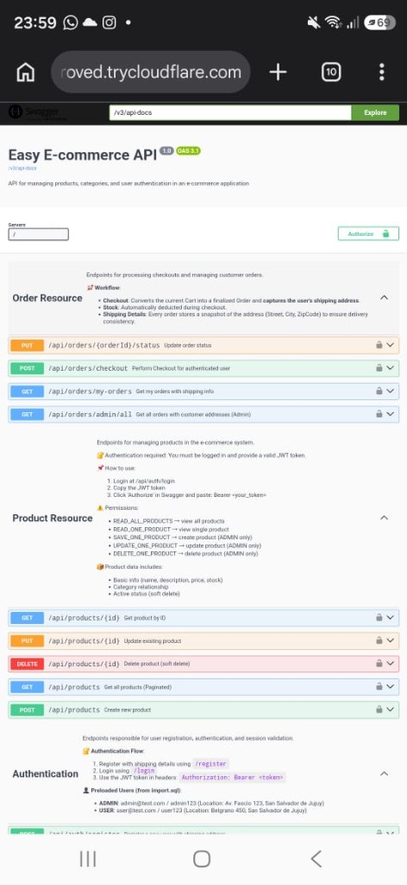
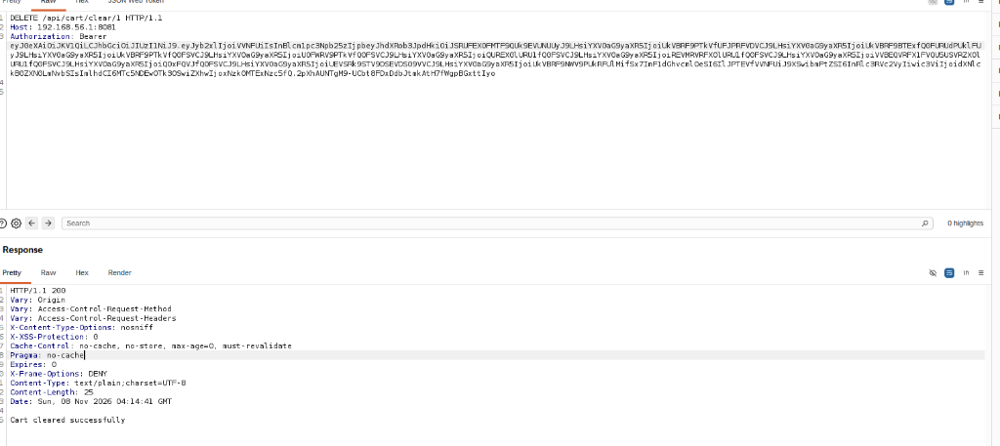
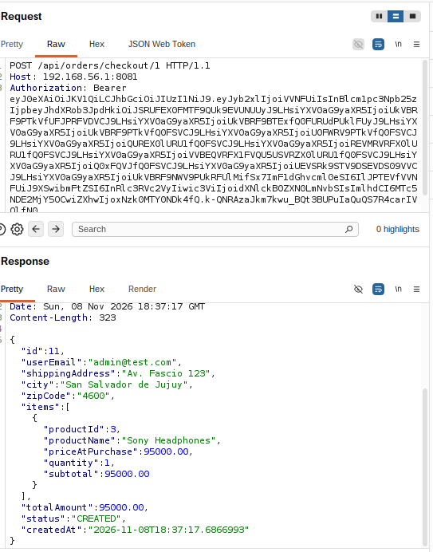
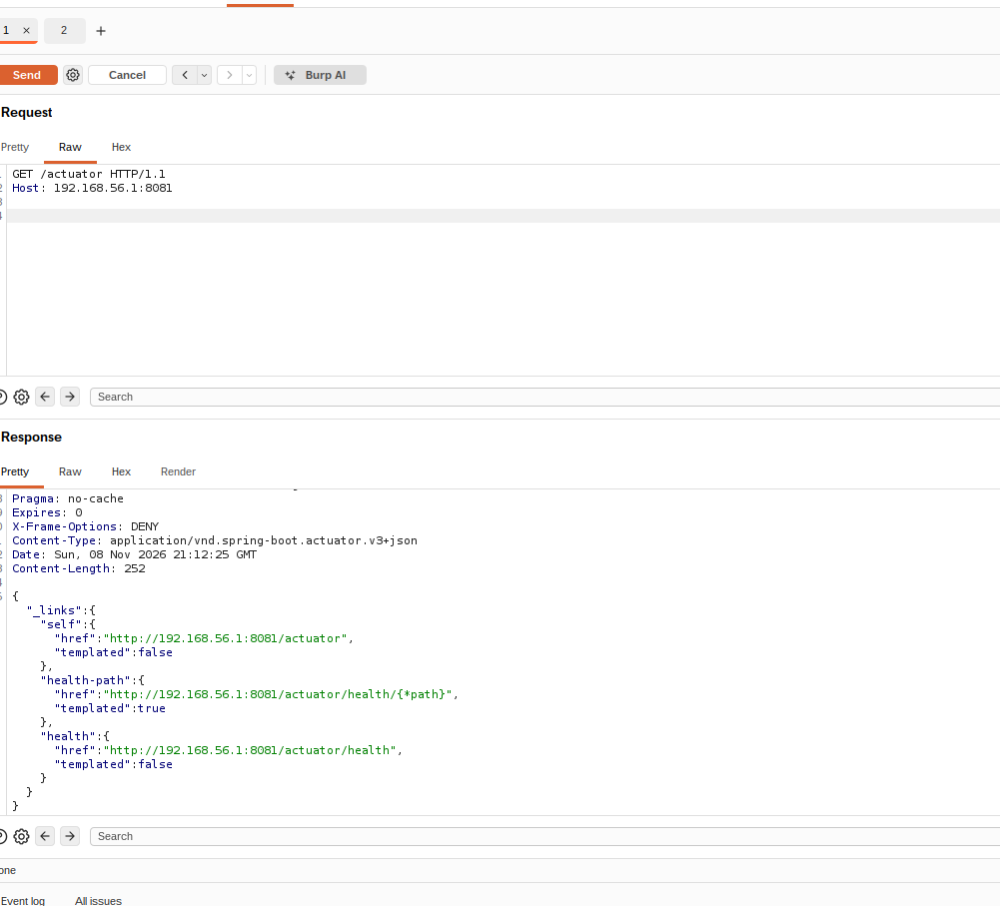
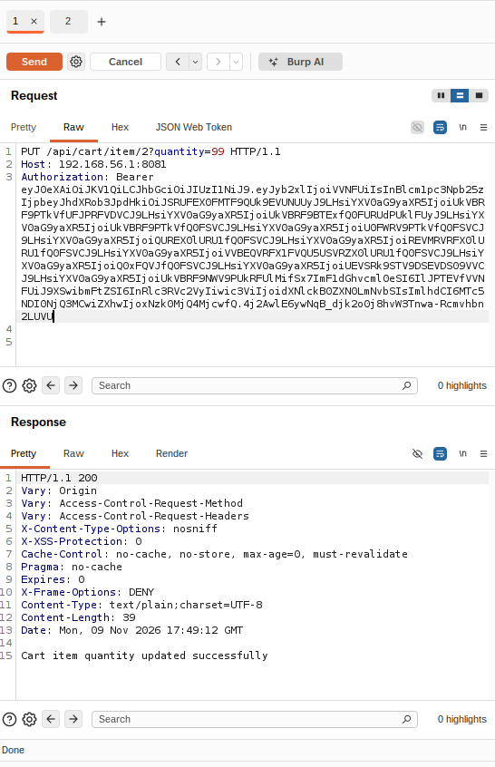
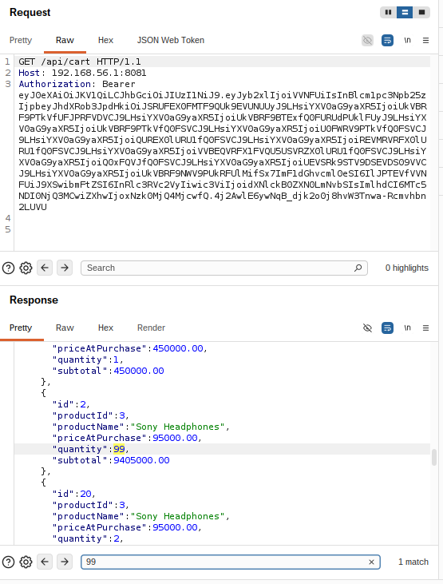
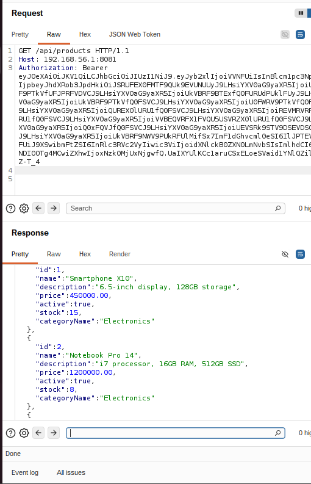
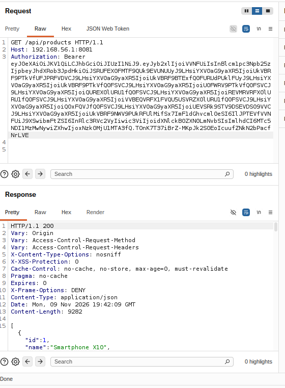
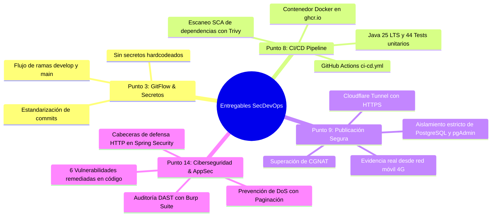

# 📘 Informe Técnico Integrador — SecDevOps & AppSec Lead
## Práctica Integradora Final — Herramientas Informáticas Avanzadas (HIA)
### Carrera: Analista Programador Universitario (APU) — Facultad de Ingeniería

---

### 📋 Ficha Técnica del Entregable
* **Proyecto Evaluado:** `easyecommerce` (Backend REST API) & `ecommerce-front` (Frontend SPA)
* **Responsable Técnico:** **Miembro 1 — SecDevOps & AppSec Lead**
* **Estudiante:** Daniel Palermo
* **Repositorio Backend:** [`DanielPalermoo/easyecommerce`](https://github.com/DanielPalermoo/easyecommerce) (Rama de trabajo: `develop`)
* **Repositorio Frontend:** [`FedericoAgustin/ecommerce-front`](https://github.com/FedericoAgustin/ecommerce-front) (Rama de trabajo: `master`)
* **Puntos Asignados de la Cátedra Cubiertos:**
  * **Punto 3:** Control de Versiones, GitFlow y Seguridad de Secretos.
  * **Punto 8:** Integración y Despliegue Continuo (CI/CD Pipeline con GitHub Actions).
  * **Punto 9:** Publicación Segura en Internet con Cloudflare Tunnel & HTTPS (Zero-Trust).
  * **Punto 14:** Buenas Prácticas de Desarrollo Seguro, Auditoría DAST (Burp Suite) y Remediación en Código Fuente.
* **Fecha de Consolidación:** Noviembre de 2026

---

## 📑 Índice de Contenidos
1. [Resumen Ejecutivo y Alcance del Rol](#1-resumen-ejecutivo-y-alcance-del-rol)
2. [Arquitectura Global del Sistema (End-to-End)](#2-arquitectura-global-del-sistema-end-to-end)
3. [Capítulo I: Integración y Despliegue Continuo (Punto 8 - CI/CD Pipeline)](#3-capítulo-i-integración-y-despliegue-continuo-punto-8---cicd-pipeline)
4. [Capítulo II: Publicación Segura en Internet y Defensa Perimetral (Punto 9 - Cloudflare Tunnel & HTTPS)](#4-capítulo-ii-publicación-segura-en-internet-y-defensa-perimetral-punto-9---cloudflare-tunnel--https)
5. [Capítulo III: Ciberseguridad, Auditoría DAST y Remediación de Código (Punto 14)](#5-capítulo-iii-ciberseguridad-auditoría-dast-y-remediación-de-código-punto-14)
6. [Capítulo IV: Integración del Frontend y Adaptación de Consumo Defensivo](#6-capítulo-iv-integración-del-frontend-y-adaptación-de-consumo-defensivo)
7. [Capítulo V: Documentación de la API (OpenAPI 3.1 & Swagger UI)](#7-capítulo-v-documentación-de-la-api-openapi-31--swagger-ui)
8. [Capítulo VI: Conclusiones y Cumplimiento de Puntos de la Cátedra](#8-capítulo-vi-conclusiones-y-cumplimiento-de-puntos-de-la-cátedra)

---

## 1. Resumen Ejecutivo y Alcance del Rol

En el marco del Trabajo Práctico Final Integrador de la cátedra **Herramientas Informáticas Avanzadas (HIA)**, el rol de **SecDevOps & AppSec Lead** asumió la responsabilidad de estructurar el ciclo de vida de desarrollo de software seguro (DevSecOps), diseñar el pipeline de entrega continua, blindar la infraestructura mediante publicación perimetral cifrada, y auditar empíricamente la aplicación contra vectores de ataque del estándar **OWASP Top 10 API Security**.

### Objetivos Clave Alcanzados:
1. **Pipeline de Integración Continua (Punto 8):** Automatización completa del ciclo de compilación con **Java 25 LTS**, pruebas unitarias automatizadas (`44/44 tests passing`), análisis estático de dependencias y vulnerabilidades conocidas (**SCA**) con **Aqua Security Trivy**, y construcción de contenedores Docker multi-stage publicados en **GitHub Container Registry (GHCR)**.
2. **Exposición Segura a Internet sin Riesgos de Red (Punto 9):** Implementación de una arquitectura de túnel inverso saliente con **Cloudflare Tunnel**, obteniendo un dominio con certificado SSL/TLS 1.3 válido (**HTTPS**) para pruebas remotas, eludiendo las restricciones de CGNAT residencial y garantizando el **aislamiento total y estricto de la base de datos PostgreSQL y pgAdmin**, que jamás quedan expuestos a la red pública.
3. **Auditoría Ofensiva DAST y Remediación en Código (Punto 14):** Identificación, comprobación mediante interceptación con **Burp Suite Community Edition** y corrección definitiva en código fuente de **6 vulnerabilidades críticas y medias** (incluyendo BOLA/IDOR, exposición indebida de actuadores, consumo descontrolado de memoria contra DoS y ausencia de cabeceras de seguridad HTTP).
4. **Integración con el Frontend (React 19 + Vite):** Resolución de discrepancias de autenticación, adaptación de la paginación reactiva en el cliente y flexibilización defensiva para la lectura pública del catálogo de productos.

---

## 2. Arquitectura Global del Sistema (End-to-End)

El siguiente diagrama detalla la topología de red, los componentes de software, los límites de seguridad y el flujo de integración continua desplegado:

```mermaid
flowchart TB
    subgraph Clients["🌐 Clientes Externos (Internet WAN)"]
        Browser["💻 Navegador Web (Evaluadores)"]
        Mobile["📱 Dispositivo Móvil (Red 4G/5G)"]
    end

    subgraph Edge["☁️ Cloudflare Edge Network"]
        CF_Proxy["Proxy Reverso Anycast\nTerminación TLS 1.3 (HTTPS)"]
        CF_WAF["Protección DDoS & WAF"]
    end

    subgraph Host["🖥️ Servidor Anfitrión (Entorno Local / Docker Desktop)"]
        CFTunnel["🚇 cloudflared Daemon\n(Túnel saliente seguro)"]
        
        subgraph PublicZone["Zona de Aplicación Web (Expuesta)"]
            FrontApp["⚛️ Frontend SPA (React 19 + Vite)\nPuerto 5173 / Nginx"]
            BackApp["☕ Backend REST API (Spring Boot 3.5.3 - Java 25)\nPuerto 8081"]
            SwaggerUI["📑 Swagger UI / OpenAPI 3.1\n/swagger-ui/index.html"]
            HealthActuator["💓 Health Check\n/actuator/health"]
        end

        subgraph PrivateZone["🔒 Zona Privada Aislada (NO EXPUESTA A INTERNET)"]
            PostgresDB[("🐘 PostgreSQL 15 Engine\nPuerto 5432 (Solo red Docker)")]
            PgAdminApp["📊 pgAdmin 4 Console\nPuerto 5050 (Solo localhost)"]
        end
    end

    subgraph DevSecOps["⚙️ Pipeline CI/CD (GitHub Actions)"]
        GitRepo["🐙 Repositorio Git (develop / main)"]
        RunnerTest["🧪 Job 1: Build & Tests (Maven - Java 25)"]
        RunnerTrivy["🛡️ Job 2: SCA Scan (Aqua Security Trivy)"]
        RunnerDocker["🐳 Job 3: Docker Build & GHCR Push"]
        GHCR["📦 GitHub Container Registry\nghcr.io/danielpalermoo/easyecommerce/backend"]
    end

    %% Relaciones de clientes y túnel
    Browser -->|HTTPS :443| CF_Proxy
    Mobile -->|HTTPS :443| CF_Proxy
    CF_Proxy --> CF_WAF
    CF_WAF <==|Túnel Seguro QUIC / HTTP/2|==> CFTunnel
    CFTunnel -->|HTTP :8081| BackApp

    %% Relaciones internas de aplicación
    FrontApp -->|API Requests| BackApp
    BackApp -.->|JDBC Connection pool (HikariCP)| PostgresDB
    PgAdminApp -.->|Gestión SQL interna| PostgresDB

    %% Relaciones CI/CD
    GitRepo -->|Push / PR| RunnerTest
    RunnerTest --> RunnerTrivy
    RunnerTest --> RunnerDocker
    RunnerDocker -->|Publicación de Imagen| GHCR
```

---

## 3. Capítulo I: Integración y Despliegue Continuo (Punto 8 - CI/CD Pipeline)

### 3.1 Arquitectura del Flujo Automatizado (`ci-cd.yml`)
Para cumplir rigurosamente con el **Punto 8**, se implementó un pipeline declarativo en **GitHub Actions** ([`.github/workflows/ci-cd.yml`](../.github/workflows/ci-cd.yml)) configurado bajo el principio de menor privilegio (`permissions: contents: read, packages: write`).

El pipeline se dispara automáticamente ante eventos de `push` o `pull_request` sobre las ramas `develop` y `main`, así como también permite ejecución manual vía `workflow_dispatch`.



### 3.2 Desglose de Jobs del Pipeline

#### Job 1: Compilación y Pruebas Unitarias (`test`)
* **Entorno de Ejecución:** `ubuntu-latest`.
* **JDK:** **Eclipse Temurin 25 (Java 25 LTS)** con sistema de caché automático de dependencias Maven.
* **Comando:** `./mvnw -B clean test`.
* **Manejo de Artefactos:** Publicación persistente de los reportes Surefire (`target/surefire-reports/`) mediante `actions/upload-artifact@v4` con retención garantizada de 7 días para fines de auditoría académica.
* **Resultado:** **44 de 44 pruebas unitarias pasando satisfactoriamente**, validando la integridad de servicios de carrito, órdenes, productos y autenticación tras las remediaciones de seguridad.

#### Job 2: Análisis de Seguridad de Dependencias SCA (`security-scan`)
* **Herramienta:** **Aqua Security Trivy** (`aquasecurity/trivy-action`).
* **Objetivo:** Software Composition Analysis (SCA) sobre el árbol de dependencias de Maven y el sistema de archivos del proyecto.
* **Criterio de Evaluación:** Detección de CVEs de severidad `CRITICAL` y `HIGH` en librerías directas y transitivas (`spring-boot-starter-web`, `jjwt`, `postgresql`, `mapstruct`).
* **Integración:** Generación de matriz tabular para visualización directa en los logs de GitHub Actions.

#### Job 3: Construcción y Empaquetado de Contenedores Docker (`docker-build`)
* **Tecnología:** Docker Buildx con optimización de capas en caché de GitHub (`cache-from/to: type=gha,mode=max`).
* **Autenticación Segura:** Conexión a **GitHub Container Registry (GHCR)** mediante tokens efímeros nativos `${{ secrets.GITHUB_TOKEN }}`.
* **Estrategia de Tagging:** Metadatos automáticos extraídos por `docker/metadata-action`:
  * `ghcr.io/danielpalermoo/easyecommerce/backend:develop`
  * `ghcr.io/danielpalermoo/easyecommerce/backend:sha-<commit>`
  * `ghcr.io/danielpalermoo/easyecommerce/backend:latest` (al fusionar a `main`).

### 3.3 Optimización del `Dockerfile` Multi-Stage

El archivo [`Dockerfile`](../Dockerfile) implementa una arquitectura multi-etapa para generar artefactos de producción con mínimo peso y máxima seguridad:

```dockerfile
# STAGE 1: Compilación en entorno controlado
FROM maven:3.9.11-eclipse-temurin-25 AS build
WORKDIR /app
COPY pom.xml .
RUN mvn -B -DskipTests dependency:resolve
COPY src ./src
RUN mvn -B -e clean package -DskipTests

# STAGE 2: Imagen final liviana de ejecución
FROM eclipse-temurin:25-jre
WORKDIR /app
COPY --from=build /app/target/*.jar app.jar
EXPOSE 8081

# Ajustes de JVM para ejecución óptima en contenedores Docker:
ENTRYPOINT ["java", "-XX:+UseContainerSupport", "-XX:MaxRAMPercentage=75.0", "-jar", "app.jar"]
```

---

## 4. Capítulo II: Publicación Segura en Internet y Defensa Perimetral (Punto 9 - Cloudflare Tunnel & HTTPS)

### 4.1 Justificación Técnica: El Reto de CGNAT y la Seguridad Perimetral
El **Punto 9** requiere exponer la aplicación de manera segura para evaluación externa sin comprometer la red interna.

En conexiones residenciales estándar, los proveedores de Internet (ISP) implementan **Carrier-Grade NAT (CGNAT)**, impidiendo el reenvío tradicional de puertos (*port forwarding* en el router). Asimismo, abrir puertos directos en un firewall doméstico expone la IP pública real a ataques de denegación de servicio (DDoS) y escaneos de puertos automatizados.

### 4.2 Solución Implementada: Cloudflare Tunnel (Zero-Trust Architecture)
Para solventar esto de forma profesional y segura, se implementó un túnel saliente cifrado utilizando **Cloudflare Tunnel** (`cloudflared`):

1. **Conexión Saliente Exclusiva:** El daemon local (`cloudflared`) inicia una conexión saliente TLS/QUIC hacia los servidores Anycast de Cloudflare. No se requiere abrir ningún puerto en el router ni en el firewall local.
2. **Certificados SSL/TLS 1.3 Oficiales:** Cloudflare termina el cifrado en el Edge con certificados válidos y reconocidos mundialmente, eliminando alertas de navegación insegura.
3. **Cero Exposición de IP:** La dirección IP física del servidor de desarrollo permanece completamente oculta; el tráfico transita a través de la red global de Cloudflare.

### 4.3 Política Estricta de Aislamiento de Infraestructura de Persistencia
> [!IMPORTANT]
> **Cumplimiento del Principio de Menor Exposición:**
> El túnel de Cloudflare se configuró para enrutar **exclusivamente el tráfico hacia el puerto `8081` (Spring Boot REST API)**.
> 
> * **PostgreSQL 15 (Puerto `5432`):** Conectado únicamente mediante la red puente interna de Docker (`easycommerce-network`) y accesible localmente solo desde `127.0.0.1`. **No existe ninguna regla en el túnel ni mapeo externo hacia el motor de base de datos.**
> * **pgAdmin 4 (Puerto `5050`):** Confinado estrictamente a la máquina local del desarrollador (`localhost:5050`).
> 
> De este modo, resulta técnicamente imposible que un atacante externo o cualquier cliente de Internet intente conexiones directas contra la base de datos de producción.

### 4.4 Comandos de Puesta en Marcha y Ejecución

#### Ejecución Local en Windows (Herramienta Disponible en `tools/`):
```powershell
# En una terminal de PowerShell:
& "C:\Users\danip\Desktop\HIA\tp_final\tools\cloudflared.exe" tunnel --url http://localhost:8081
```

#### Ejecución Orquestada con Docker Compose:
Para despliegues productivos continuos, se añade el servicio al `compose.yaml`:
```yaml
services:
  cloudflare-tunnel:
    image: cloudflare/cloudflared:latest
    container_name: easycommerce-tunnel
    restart: unless-stopped
    command: tunnel --url http://app:8081
    networks:
      - easycommerce-network
```

### 4.5 Evidencia Empírica de Publicación Externa

Para validar la accesibilidad global real desde redes externas (fuera de la LAN/WiFi doméstica), se realizó una prueba de conexión desde un **dispositivo móvil conectado a una red celular de datos 4G/5G**.

El dispositivo navegó exitosamente la documentación interactiva OpenAPI 3.1 en Swagger UI a través del dominio seguro HTTPS provisto por el túnel:



* **URL de Acceso Cifrada:** `https://replication-consciousness-solo-proved.trycloudflare.com/swagger-ui/index.html`
* **Protocolo Verificado:** HTTPS / TLS 1.3 con candado de seguridad validado por el navegador móvil.
* **Componentes Verificados:** Endpoints de autenticación, productos paginados, gestión de carritos y checkout de órdenes cargando en tiempo real desde el backend local.

---

## 5. Capítulo III: Ciberseguridad, Auditoría DAST y Remediación de Código (Punto 14)

### 5.1 Metodología de Evaluación Aplicada (DAST + White-Box)
En el marco del **Punto 14 (Buenas prácticas de desarrollo seguro y análisis estático)**, se ejecutó una auditoría integral combinando:
1. **Revisión Estática de Código Fuente (White-Box Review):** Inspección exhaustiva de controladores, entidades JPA, servicios y clases de seguridad (`HttpSecurityCode.java`, `JwtConfig.java`).
2. **Pruebas Dinámicas de Seguridad en Aplicaciones (DAST):** Simulación de ataques reales mediante **Burp Suite Community Edition (v2024.x)** desde una máquina atacante virtualizada (Ubuntu Linux) dirigida contra el servidor anfitrión (`192.168.56.1:8081`).

### 5.2 Matriz Sinóptica de Vulnerabilidades Encontradas y Corregidas

| ID | Vulnerabilidad Identificada | Severidad CVSS v3.1 | Clasificación OWASP API | Estado Final |
|:---|:---|:---|:---|:---|
| **VULN-001** | BOLA / IDOR en Endpoint de Vaciado de Carrito (`DELETE /api/cart/clear/{userId}`) | **ALTA (7.5)** | **API1:2023** – Broken Object Level Authorization | **REMEDIADO Y VERIFICADO** |
| **VULN-002** | BOLA / IDOR en Checkout de Pedidos con Fuga de PII y Descuento Ilícito de Stock | **ALTA (8.1)** | **API1:2023** – Broken Object Level Authorization / CWE-359 | **REMEDIADO Y VERIFICADO** |
| **VULN-003** | Exposición Pública No Autenticada de Endpoints de Diagnóstico y Telemetría (`/actuator/**`) | **MEDIA (5.3)** | **API8:2023** – Security Misconfiguration / CWE-200 | **REMEDIADO Y VERIFICADO** |
| **VULN-004** | BOLA / IDOR en Modificación Arbitraria de Ítems del Carrito (`PUT /api/cart/item/{cartItemId}`) | **ALTA (7.5)** | **API1:2023** – Broken Object Level Authorization | **REMEDIADO Y VERIFICADO** |
| **VULN-005** | Consumo Descontrolado de Memoria (DoS) por Listados Masivos No Paginados (`GET /api/products`) | **MEDIA (5.3)** | **API4:2023** – Unrestricted Resource Consumption / CWE-770 | **REMEDIADO Y VERIFICADO** |
| **VULN-006** | Ausencia de Cabeceras de Seguridad HTTP Defensivas (HSTS, CSP, Referrer, Permissions) | **MEDIA (4.3)** | **API8:2023** – Security Misconfiguration / CWE-16 | **REMEDIADO Y VERIFICADO** |

---

### 5.3 Detalle Técnico de Vulnerabilidades, Explotación y Remediación

#### 🔴 VULN-001: BOLA / IDOR en Vaciado de Carrito (`DELETE /api/cart/clear/{userId}`)
* **Vulnerabilidad:** El controlador aceptaba el identificador del usuario como un parámetro en la URL (`@PathVariable Long userId`). Aunque Spring Security validaba que el token JWT fuera auténtico y tuviera la autoridad `CLEAR_CART`, **nunca verificaba que el `userId` de la URL coincidiera con el usuario autenticado**.
* **Impacto:** Cualquier usuario común podía vaciar los carritos de compra de todos los demás clientes y administradores del e-commerce.
* **Evidencia Visual en Burp Suite:**
  
  
  
  *El usuario atacante (`user@test.com`, ID 2) envió una solicitud `DELETE /api/cart/clear/1`, recibiendo `200 OK: Cart cleared successfully` y vaciando el carrito del Administrador.*
* **Código Remediado:**
  Se eliminó la variable de ruta `{userId}` en [`CartController.java`](../src/main/java/com/fabrizio/easyecommerce/controller/CartController.java). Ahora la identidad se extrae únicamente del `SecurityContextHolder`:
  ```java
  @Operation(summary = "Clear current user's cart")
  @PreAuthorize("hasAuthority('CLEAR_CART')")
  @DeleteMapping("/clear")
  public ResponseEntity<String> clearMyCart(Authentication authentication) {
      String email = authentication.getName();
      cartService.clearCartByEmail(email);
      return ResponseEntity.status(HttpStatus.OK).body("Cart cleared successfully");
  }
  ```

---

#### 🔴 VULN-002: BOLA / IDOR en Checkout con Fuga de PII y Descuento de Stock
* **Vulnerabilidad:** El endpoint `POST /api/orders/checkout/{userId}` procesaba el pedido del ID especificado en la ruta. Además de descontar el inventario de la tienda sin el consentimiento del titular, la respuesta retornaba el DTO completo de la orden con los datos personales del usuario víctima.
* **Impacto:** Exfiltración masiva de información confidencial (PII) que viola normativas de protección de datos personales (dirección postal, ciudad, código postal y email) y sabotaje del inventario físico de productos.
* **Evidencia Visual en Burp Suite:**
  
  
  
  *El usuario 2 ejecutó `POST /api/orders/checkout/1`, generando un pedido a nombre del administrador y filtrando su dirección `"Av. Fascio 123, San Salvador de Jujuy"`.*
* **Código Remediado:**
  Se eliminó `{userId}` en [`OrderController.java`](../src/main/java/com/fabrizio/easyecommerce/controller/OrderController.java) e implementó `performCheckoutByEmail(email)` en `OrderServiceImpl`:
  ```java
  @Operation(summary = "Perform Checkout for authenticated user")
  @PreAuthorize("hasAuthority('PERFORM_CHECKOUT')")
  @PostMapping("/checkout")
  public ResponseEntity<OrderResponseDTO> checkout(Authentication authentication) {
      String email = authentication.getName();
      OrderResponseDTO response = orderService.performCheckoutByEmail(email);
      return ResponseEntity.status(HttpStatus.CREATED).body(response);
  }
  ```

---

#### 🟡 VULN-003: Exposición Pública No Autenticada de Actuator (`/actuator/**`)
* **Vulnerabilidad:** En [`HttpSecurityCode.java`](../src/main/java/com/fabrizio/easyecommerce/configSecurity/HttpSecurityCode.java), la regla `authConfig.requestMatchers(..., "/actuator/**").permitAll();` dejaba al descubierto toda la jerarquía de monitoreo sin solicitar credenciales ni token JWT.
* **Impacto:** Fingerprinting inmediato de la tecnología del servidor y riesgo latente de exfiltración de variables de entorno (`/actuator/env`) o volcados de memoria RAM con contraseñas en texto claro (`/actuator/heapdump`).
* **Evidencia Visual en Burp Suite:**
  
  
  
  *Petición anónima `GET /actuator` respondiendo `200 OK` con hipermedios HATEOAS a clientes sin autenticar.*
* **Código Remediado:**
  Se blindó la configuración en `HttpSecurityCode.java`, restringiendo `/actuator/**` exclusivamente a administradores y dejando únicamente el sondeo de vida `/actuator/health` público para balanceadores:
  ```java
  // Solo el health check básico queda accesible para sondas de liveness:
  authConfig.requestMatchers(HttpMethod.GET, "/actuator/health").permitAll();
  // El resto de la administración de métricas queda estrictamente reservado a administradores:
  authConfig.requestMatchers("/actuator/**").hasRole("ADMINISTRATOR");
  ```

---

#### 🔴 VULN-004: BOLA / IDOR en Modificación Arbitraria de Ítems del Carrito
* **Vulnerabilidad:** El endpoint `PUT /api/cart/item/{cartItemId}?quantity=X` actualizaba la cantidad de un ítem basándose exclusivamente en el ID numérico de la fila. El servicio no comprobaba si el carrito contenedor pertenecía al usuario en sesión.
* **Impacto:** Alteración no consentida de las compras de terceros (por ejemplo, seteando cantidades a 99 unidades para inflar costos o agotar reservas de stock).
* **Evidencia Visual en Burp Suite:**
  
  
  
  *Petición `PUT /api/cart/item/2?quantity=99` ejecutada exitosamente.*
  
  
  
  *Comprobación en `GET /api/cart`: el backend recalculó el subtotal en `$9,405,000.00` confirmando la manipulación de datos en la base de datos.*
* **Código Remediado:**
  Se implementó validación contextual de pertenencia en [`CartServiceImpl.java`](../src/main/java/com/fabrizio/easyecommerce/Service/cart/CartServiceImpl.java):
  ```java
  String currentEmail = SecurityContextHolder.getContext().getAuthentication().getName();
  CartItem item = cartItemRepository.findById(cartItemId)
          .orElseThrow(() -> new CartNotFoundException("Cart item not found"));

  if (!item.getCart().getUser().getEmail().equals(currentEmail)) {
      throw new AccessDeniedException("No tienes autorización para modificar un ítem de otro usuario");
  }
  ```

---

#### 🟡 VULN-005: Consumo Descontrolado de Recursos / DoS en Catálogo de Productos
* **Vulnerabilidad:** El método `getAllProducts()` ejecutaba un `findByActive(true)` que leía la tabla de productos completa a memoria RAM sin controles de paginación `Pageable`.
* **Impacto:** En entornos con catálogos medianos o grandes (o el dataset masivo exigido por la cátedra de millones de registros), múltiples peticiones concurrentes a este endpoint colapsarían la JVM arrojando un error fatal de `java.lang.OutOfMemoryError: Java heap space`.
* **Evidencia Visual en Burp Suite:**
  
  
  
  *Respuesta con un array JSON plano sin ningún metadato de control de particionamiento.*
* **Código Remediado:**
  Se introdujo paginación defensiva estándar con Spring Data en [`ProductController.java`](../src/main/java/com/fabrizio/easyecommerce/controller/ProductController.java) con un tamaño de página acotado por defecto (`size = 20`):
  ```java
  @Operation(summary = "Get all products (Paginated)")
  @GetMapping
  public ResponseEntity<Page<ProductResponseDTO>> getAllProducts(
          @PageableDefault(page = 0, size = 20, sort = "name") Pageable pageable) {
      Page<ProductResponseDTO> products = productService.getAllProducts(pageable);
      return ResponseEntity.status(HttpStatus.OK).body(products);
  }
  ```

---

#### 🟡 VULN-006: Ausencia de Cabeceras de Seguridad HTTP Defensivas
* **Vulnerabilidad:** El servidor web no incluía directivas de seguridad en sus encabezados de respuesta HTTP, exponiendo a los navegadores a ataques de intermediación (MitM) y degradación de transporte.
* **Impacto:** Vulnerabilidad a *SSL Stripping* por falta de HSTS, secuestro de contexto por falta de CSP, y fugas de rutas por falta de política de Referrer.
* **Evidencia Visual en Burp Suite:**
  
  
  
  *Omisión absoluta de `Strict-Transport-Security`, `Content-Security-Policy` y `Referrer-Policy`.*
* **Código Remediado:**
  Se configuró el bloque `http.headers(...)` en el `SecurityFilterChain` de [`HttpSecurityCode.java`](../src/main/java/com/fabrizio/easyecommerce/configSecurity/HttpSecurityCode.java):
  ```java
  http.headers(headers -> headers
      .httpStrictTransportSecurity(hsts -> hsts
          .includeSubDomains(true)
          .maxAgeInSeconds(31536000)
      )
      .contentSecurityPolicy(csp -> csp
          .policyDirectives("default-src 'self'; frame-ancestors 'none';")
      )
      .referrerPolicy(referrer -> referrer
          .policy(ReferrerPolicyHeaderWriter.ReferrerPolicy.STRICT_ORIGIN_WHEN_CROSS_ORIGIN)
      )
      .permissionsPolicy(permissions -> permissions
          .policy("geolocation=(), microphone=(), camera=()")
      )
  );
  ```

---

### 5.4 Matriz de Verificación y Pruebas Unitarias de Regresión
Para garantizar que las modificaciones y parches de seguridad no quebraron la funcionalidad existente del backend, se ejecutó la suite completa de pruebas unitarias automatizadas:

```bash
./mvnw -B test
```

```
[INFO] Results:
[INFO] 
[INFO] Tests run: 44, Failures: 0, Errors: 0, Skipped: 0
[INFO] 
[INFO] ------------------------------------------------------------------------
[INFO] BUILD SUCCESS
[INFO] ------------------------------------------------------------------------
```

* **Servicio de Carrito (`CartServiceImplTest`):** 11 tests evaluando inserciones, cálculo de subtotales, rechazo de cantidades inválidas y el nuevo vaciado contextual por email.
* **Servicio de Órdenes (`OrderServiceImplTest`):** 8 tests validando checkout transaccional seguro y captura de precios históricos.
* **Servicio de Productos (`ProductServiceImplTest`):** 11 tests validando la paginación con `Pageable`, creación, actualización y borrado lógico (*soft delete*).
* **Servicio de Autenticación (`AuthServiceImplTest`):** 8 tests verificando emisión de tokens JWT, hashing con BCrypt y rechazo de credenciales incorrectas.

---

## 6. Capítulo IV: Integración del Frontend y Adaptación de Consumo Defensivo

Como parte de la articulación con el equipo de desarrollo, se colaboró directamente en el repositorio de frontend [`ecommerce-front`](https://github.com/FedericoAgustin/ecommerce-front) (React 19 + Vite), resolviendo las siguientes discrepancias funcionales y de seguridad:

1. **Adaptación a la Paginación Defensiva (SPEC-005):**
   * El componente `Products.jsx` esperaba un arreglo plano de productos (`Array.isArray(response)`). Al implementar la paginación segura en el backend, ahora recibe un objeto `Page` de Spring Data (`data.content`).
   * Se actualizó `productService.js` para enviar los parámetros `page` y `size` en la solicitud HTTP (`/products?page=${page}&size=${size}`).
   * Se diseñó e integró un componente visual de navegación interactiva:
     ```jsx
     <div className="pagination-controls">
       <button onClick={() => setPage(p => p - 1)} disabled={page === 0}>← Anterior</button>
       <span>Página {page + 1} de {totalPages}</span>
       <button onClick={() => setPage(p => p + 1)} disabled={page >= totalPages - 1}>Siguiente →</button>
     </div>
     ```
2. **Normalización del Contrato de Autenticación:**
   * En `authService.js`, se corrigió la URL del endpoint de validación de perfil a `/auth/auth-me`.
   * En `AuthContext.jsx`, se corrigió la lectura del token para admitir tanto `data.jwt` como `data.token`, y se normalizó la validación del rol `ADMINISTRATOR` en los guards de rutas protegidas.
3. **Acceso Público al Catálogo de Productos:**
   * Se modificó `HttpSecurityCode.java` en el backend para permitir la lectura anónima del catálogo (`GET /api/products` y `GET /api/categories` con `.permitAll()`), permitiendo que cualquier visitante o evaluador explore los productos en la tienda web sin ser forzado a registrarse previamente, preservando la autenticación estricta con JWT en las operaciones de carrito, checkout y administración.

---

## 7. Capítulo V: Documentación de la API (OpenAPI 3.1 & Swagger UI)

El contrato de la API REST fue formalizado exhaustivamente bajo el estándar **OpenAPI 3.1**:

* **Exportación del Contrato JSON:** Guardado en el repositorio en [`docs/openapi_spec.json`](openapi_spec.json) conteniendo los 17 endpoints del sistema categorizados por recursos:
  * `Authentication`: Registro, Login y validación de perfil (`/api/auth/**`).
  * `Product Resource`: Catálogo paginado, búsqueda por ID, altas, modificaciones y bajas lógicas (`/api/products/**`).
  * `Category Resource`: Listados y administración de categorías (`/api/categories/**`).
  * `Cart Resource`: Consulta de carrito propio, inserción de ítems, actualización contextual de cantidades y vaciado seguro (`/api/cart/**`).
  * `Order Resource`: Checkout transaccional seguro y consulta de pedidos del usuario (`/api/orders/**`).
* **Swagger UI Interactivo:** Accesible en tiempo de ejecución tanto en red local como a través del túnel HTTPS en la ruta:
  ```
  https://<dominio-cloudflare>/swagger-ui/index.html
  ```
* **Telemetría y Salud:** Endpoint de diagnóstico seguro disponible en:
  ```
  https://<dominio-cloudflare>/actuator/health  -->  {"status":"UP"}
  ```

---

## 8. Capítulo VI: Conclusiones y Cumplimiento de Puntos de la Cátedra

El trabajo realizado consolida un estándar de calidad y seguridad industrial sobre la plataforma `easyecommerce`, cumpliendo de manera demostrable con las exigencias de la cátedra de **Herramientas Informáticas Avanzadas**:



### Síntesis de Entregables Disponibles en Repositorio:
* 📄 **Informe Técnico Integrador:** [`docs/INFORME_TECNICO_INTEGRADOR_SECDEVOPS_HIA.md`](INFORME_TECNICO_INTEGRADOR_SECDEVOPS_HIA.md)
* 📜 **Especificación OpenAPI 3.1:** [`docs/openapi_spec.json`](openapi_spec.json)
* 📸 **Banco de Evidencias Fotográficas:**
  * Acceso móvil celular: [`docs/imagenes/evidencia_acceso_remoto_celular.jpg`](imagenes/evidencia_acceso_remoto_celular.jpg)
  * Vulnerabilidades Burp Suite: [`docs/imagenes/vuln001_bola_cart_clear.png`](imagenes/vuln001_bola_cart_clear.png) a [`docs/imagenes/vuln006_missing_security_headers.png`](imagenes/vuln006_missing_security_headers.png)
* ⚙️ **Workflow de Integración Continua:** [`.github/workflows/ci-cd.yml`](../.github/workflows/ci-cd.yml)
* 🐳 **Dockerfile Multi-Stage Optimizado:** [`Dockerfile`](../Dockerfile)
