# 📘 Informe Técnico Integrador — SecDevOps & AppSec Lead
## Práctica Integradora Final — Herramientas Informáticas Avanzadas (HIA)
### Carrera: Analista Programador Universitario (APU) — Facultad de Ingeniería

---

### 📋 Ficha Técnica del Entregable
* **Proyecto Evaluado:** `easyecommerce` (Monorepo Backend REST API & Frontend SPA)
* **Responsable Técnico:** **Miembro 1 — SecDevOps & AppSec Lead**
* **Estudiante:** Daniel Palermo
* **Repositorio Unificado:** [`DanielPalermoo/easyecommerce`](https://github.com/DanielPalermoo/easyecommerce) (Rama de trabajo principal: `develop`)
* **Puntos Asignados de la Cátedra Cubiertos:**
  * **Punto 3:** Control de Versiones, GitFlow y Seguridad de Secretos.
  * **Punto 7:** Orquestación Integral de Infraestructura con Docker Compose.
  * **Punto 8:** Integración y Despliegue Continuo (CI/CD Pipeline con GitHub Actions - 6 Jobs).
  * **Punto 9:** Publicación Segura en Internet con Cloudflare Tunnel & HTTPS (Zero-Trust).
  * **Punto 14:** Buenas Prácticas de Desarrollo Seguro, Auditoría DAST (Burp Suite) y Remediación en Código Fuente.
* **Fecha de Consolidación:** Noviembre de 2026

---

## 📑 Índice de Contenidos
1. [Resumen Ejecutivo y Alcance del Rol](#1-resumen-ejecutivo-y-alcance-del-rol)
2. [Arquitectura Global del Sistema (End-to-End)](#2-arquitectura-global-del-sistema-end-to-end)
3. [Capítulo I: Integración y Despliegue Continuo (Punto 8 - CI/CD Pipeline de 6 Jobs)](#3-capítulo-i-integración-y-despliegue-continuo-punto-8---cicd-pipeline-de-6-jobs)
4. [Capítulo II: Orquestación de Infraestructura Unificada (Punto 7 - Docker Compose)](#4-capítulo-ii-orquestación-de-infraestructura-unificada-punto-7---docker-compose)
5. [Capítulo III: Publicación Segura en Internet y Defensa Perimetral (Punto 9 - Cloudflare Tunnel & HTTPS)](#5-capítulo-iii-publicación-segura-en-internet-y-defensa-perimetral-punto-9---cloudflare-tunnel--https)
6. [Capítulo IV: Ciberseguridad, Auditoría DAST y Remediación de Código (Punto 14)](#6-capítulo-iv-ciberseguridad-auditoría-dast-y-remediación-de-código-punto-14)
7. [Capítulo V: Unificación del Frontend SPA y Proxy Inverso Nginx](#7-capítulo-v-unificación-del-frontend-spa-y-proxy-inverso-nginx)
8. [Capítulo VI: Documentación de la API (OpenAPI 3.1 & Swagger UI)](#8-capítulo-vi-documentación-de-la-api-openapi-31--swagger-ui)
9. [Capítulo VII: Conclusiones y Cumplimiento de Puntos de la Cátedra](#9-capítulo-vii-conclusiones-y-cumplimiento-de-puntos-de-la-cátedra)

---

## 1. Resumen Ejecutivo y Alcance del Rol

En el marco del Trabajo Práctico Final Integrador de la cátedra **Herramientas Informáticas Avanzadas (HIA)**, el rol de **SecDevOps & AppSec Lead** asumió la responsabilidad transversal de estructurar el ciclo de vida de desarrollo de software seguro (DevSecOps), diseñar el pipeline automatizado de integración y entrega continua (CI/CD), orquestar la infraestructura de microservicios con Docker Compose, blindar la aplicación mediante publicación perimetral cifrada con Cloudflare Tunnel y auditar empíricamente la seguridad contra vectores de ataque del estándar **OWASP Top 10 API Security**.

### Objetivos Clave Alcanzados:
1. **Pipeline de CI/CD Integral de 6 Jobs (Punto 8):** Automatización declarativa en GitHub Actions que valida sintaxis de Compose y Prometheus, ejecuta análisis estático y compilación del Frontend Node.js 22, ejecuta compilación y **45 pruebas unitarias** con Java 25 LTS, realiza escaneo de dependencias (**SCA**) con Aqua Security Trivy, y construye/publica las imágenes Docker multi-stage de Frontend y Backend en **GitHub Container Registry (GHCR)**.
2. **Orquestación Integral con Docker Compose (Punto 7):** Consolidación de un ecosistema productivo que reúne la aplicación web (Spring Boot + React/Nginx), persistencia aislada (PostgreSQL 15 + pgAdmin 4), observabilidad completa (Prometheus + Grafana + Node Exporter + cAdvisor + Postgres Exporter), automatización (n8n), microservicio de backups (`server.py`), mesa de ayuda (MantisBT + MariaDB) y nube documental (Nextcloud + Redis).
3. **Exposición Segura a Internet sin Riesgos de Red (Punto 9):** Implementación de una arquitectura de túnel inverso saliente con **Cloudflare Tunnel**, obteniendo un dominio con certificado SSL/TLS 1.3 válido (**HTTPS**) para pruebas remotas, eludiendo las restricciones de CGNAT residencial y garantizando el **aislamiento total y estricto de las bases de datos internas**, que jamás quedan expuestas a la red pública.
4. **Auditoría Ofensiva DAST y Remediación en Código (Punto 14):** Identificación, comprobación mediante interceptación con **Burp Suite Community Edition** y corrección definitiva en código fuente de **6 vulnerabilidades críticas y medias** (incluyendo BOLA/IDOR, exposición indebida de actuadores, consumo descontrolado de memoria contra DoS y ausencia de cabeceras de seguridad HTTP).
5. **Unificación Monorepo:** Integración de la aplicación Frontend SPA (React 19 + Vite) dentro del repositorio `easyecommerce/frontend`, configurando proxies reversos en Nginx y optimizando el contexto de build Docker (`.dockerignore`) de 95 MB a menos de 1 MB.

---

## 2. Arquitectura Global del Sistema (End-to-End)

El siguiente diagrama detalla la topología de red, los componentes de software, los límites de seguridad y el flujo de integración continua desplegado:

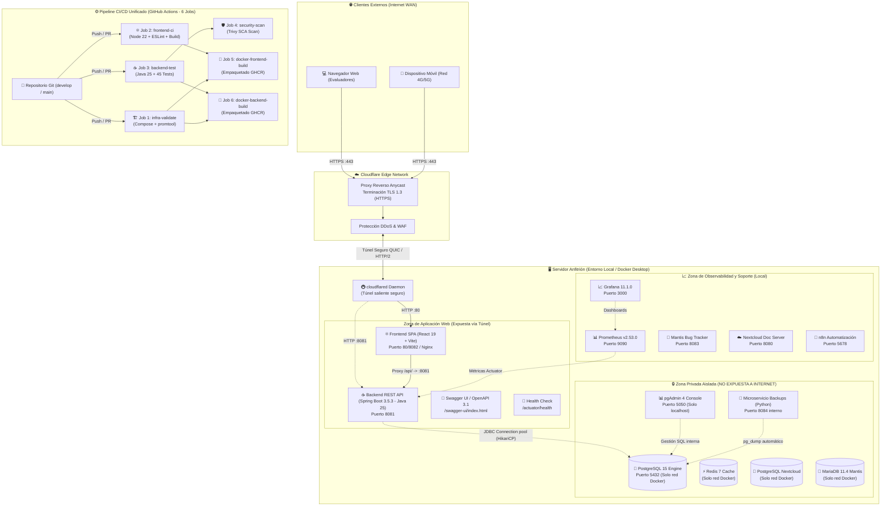

---

## 3. Capítulo I: Integración y Despliegue Continuo (Punto 8 - CI/CD Pipeline de 6 Jobs)

### 3.1 Arquitectura del Flujo Automatizado (`ci-cd.yml`)
Para cumplir rigurosamente con el **Punto 8**, se implementó un pipeline declarativo completo en **GitHub Actions** ([`.github/workflows/ci-cd.yml`](../.github/workflows/ci-cd.yml)) configurado bajo el principio de menor privilegio (`permissions: contents: read, packages: write`).

El pipeline cuenta con **6 jobs automatizados** organizados en etapas concurrentes con control estricto de dependencias:

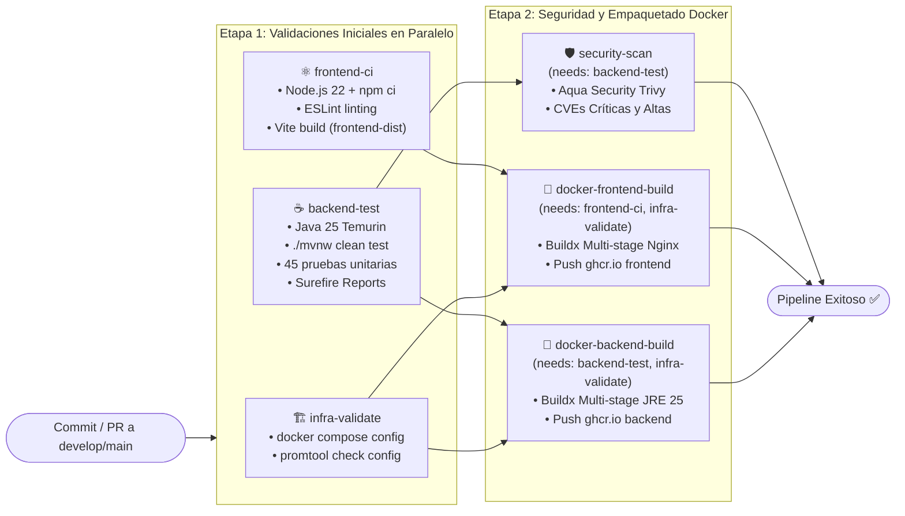

### 3.2 Desglose Exhaustivo de los 6 Jobs

#### Job 1: Validación de Infraestructura (`infra-validate`)
* **Entorno:** `ubuntu-latest`.
* **Propósito:** Prevenir errores en despliegues garantizando que la configuración de orquestación sea 100% válida antes de compilar contenedores.
* **Comandos Ejecutados:**
  1. Preparación de entorno: `cp infrastructure/.env.example infrastructure/.env`.
  2. Validación de Compose: `docker compose -f infrastructure/docker-compose.yml config --quiet`.
  3. Validación condicional defensiva: Si existe `docker-compose.tools.yml`, valida su sintaxis (`if: hashFiles('infrastructure/docker-compose.tools.yml') != ''`).
  4. Validación de sintaxis Prometheus con la utilidad oficial `promtool`:
     ```bash
     docker run --rm -v ${{ github.workspace }}/infrastructure/monitoring/prometheus.yml:/etc/prometheus/prometheus.yml \
       --entrypoint /bin/promtool prom/prometheus:v2.53.0 check config /etc/prometheus/prometheus.yml
     ```

#### Job 2: Integración Continua del Frontend (`frontend-ci`)
* **Entorno:** `ubuntu-latest`, **Node.js 22**.
* **Instalación:** `npm ci` con cache automático de dependencias (`package-lock.json`).
* **Calidad de Código (Linting):** Ejecución estricta de `npm run lint` (ESLint) validando componentes React y hooks.
* **Compilación:** `npm run build` compilando el bundle productivo mediante Vite.
* **Artefacto:** Generación y subida del artefacto `frontend-dist` con los archivos estáticos listos para producción.

#### Job 3: Compilación y Pruebas Unitarias del Backend (`backend-test`)
* **Entorno:** `ubuntu-latest`, **Eclipse Temurin 25 (Java 25 LTS)**.
* **Comando:** `./mvnw -B clean test`.
* **Resultado:** **45 de 45 pruebas unitarias pasando satisfactoriamente**, validando la integridad de servicios de carrito, órdenes, productos, categorías y autenticación tras las remediaciones de seguridad.
* **Artefacto:** Publicación del reporte Surefire (`target/surefire-reports/`) mediante `actions/upload-artifact@v4` con retención garantizada de 7 días.

#### Job 4: Análisis de Seguridad de Dependencias SCA (`security-scan`)
* **Herramienta:** **Aqua Security Trivy** (`aquasecurity/trivy-action`).
* **Dependencia:** Se ejecuta únicamente tras la aprobación de `backend-test`.
* **Caché y Optimización:** Pre-carga local de dependencias Maven (`./mvnw -B dependency:resolve -DskipTests`) para eludir restricciones de rate limit (HTTP 429) en repositorios públicos.
* **Criterio de Evaluación:** Detección de CVEs de severidad `CRITICAL` y `HIGH` en librerías directas y transitivas.

#### Job 5: Construcción y Publicación de Contenedor Frontend (`docker-frontend-build`)
* **Dependencia:** Requiere la aprobación de `frontend-ci` e `infra-validate`.
* **Tecnología:** Docker Buildx multi-stage con context en `frontend/` y caching en GitHub Actions.
* **Destino:** Publicación automatizada en **GitHub Container Registry (GHCR)**: `ghcr.io/danielpalermoo/easyecommerce/frontend`.

#### Job 6: Construcción y Publicación de Contenedor Backend (`docker-backend-build`)
* **Dependencia:** Requiere la aprobación de `backend-test` e `infra-validate`.
* **Tecnología:** Docker Buildx multi-stage con Java 25 JRE ultra liviano.
* **Destino:** Publicación automatizada en GHCR: `ghcr.io/danielpalermoo/easyecommerce/backend`.

---

## 4. Capítulo II: Orquestación de Infraestructura Unificada (Punto 7 - Docker Compose)

Toda la infraestructura del proyecto fue consolidada en el archivo maestro [`infrastructure/docker-compose.yml`](../infrastructure/docker-compose.yml), interconectada mediante la red puente `easycommerce-network`:

| Servicio | Imagen / Build | Puerto Mapeado | Propósito / Función |
|:---|:---|:---|:---|
| **`db`** | `postgres:15` | `127.0.0.1:5433:5432` | Base de datos relacional principal del e-commerce. |
| **`app`** | Multi-stage `Dockerfile` (Java 25) | `127.0.0.1:8081:8081` | Backend REST API (Spring Boot 3.5.3). |
| **`frontend`** | Multi-stage `frontend/Dockerfile` | `127.0.0.1:8082:80` | Frontend SPA (React 19 + Vite + Nginx). |
| **`pgadmin`** | `dpage/pgadmin4:8.9` | `127.0.0.1:5050:80` | Consola de administración visual PostgreSQL. |
| **`prometheus`**| `prom/prometheus:v2.53.0` | `127.0.0.1:9090:9090` | Recolección de métricas de telemetría de Actuator y DB. |
| **`grafana`** | `grafana/grafana:11.1.0` | `127.0.0.1:3000:3000` | Tableros interactivos de monitoreo en tiempo real. |
| **`postgres-exporter`** | `prometheuscommunity/postgres-exporter:v0.15.0` | Red interna | Métricas internas de PostgreSQL para Prometheus. |
| **`node-exporter`** | `prom/node-exporter:v1.8.2` | Red interna | Métricas de CPU, RAM y disco del host Linux. |
| **`cadvisor`** | `gcr.io/cadvisor/cadvisor:v0.54.1` | Red interna | Monitoreo del uso de recursos por contenedor Docker. |
| **`n8n`** | `docker.n8n.io/n8nio/n8n:2.42.7` | `127.0.0.1:5678:5678`| Motor de automatización y orquestación de flujos. |
| **`db-backup`**| `infrastructure/backup` (Python) | Red interna | Microservicio de copias de seguridad automáticas (`server.py`). |
| **`mantis-db`** | `mariadb:11.4` | Red interna | Motor MariaDB exclusivo para el sistema de tickets. |
| **`mantisbt`** | `xlrl/mantisbt:2.27.0` | `127.0.0.1:8083:80` | Sistema de gestión de incidencias y bugs (MantisBT). |
| **`db-nextCloud`**| `postgres:16` | Red interna | Base de datos PostgreSQL dedicada para Nextcloud. |
| **`redis`** | `redis:7-alpine` | Red interna | Caché en memoria para optimización de Nextcloud. |
| **`nextcloud`** | `nextcloud:31-apache` | `127.0.0.1:8080:80` | Nube documental privada para documentación del equipo. |

---

## 5. Capítulo III: Publicación Segura en Internet y Defensa Perimetral (Punto 9 - Cloudflare Tunnel & HTTPS)

### 5.1 Justificación Técnica: El Reto de CGNAT y la Seguridad Perimetral
El **Punto 9** exige exponer la aplicación a Internet para evaluación remota sin comprometer la seguridad interna.

En conexiones residenciales estándar, los proveedores de Internet (ISP) implementan **Carrier-Grade NAT (CGNAT)**, impidiendo el reenvío tradicional de puertos (*port forwarding* en el router). Asimismo, abrir puertos directos en un firewall doméstico expone la IP pública real a ataques de denegación de servicio (DDoS) y escaneos automatizados.

### 5.2 Solución Implementada: Cloudflare Tunnel (Zero-Trust Architecture)
Para solventar esto de forma profesional y segura, se implementó un túnel saliente cifrado utilizando **Cloudflare Tunnel** (`cloudflared`):

1. **Conexión Saliente Exclusiva:** El daemon local (`cloudflared`) inicia una conexión saliente TLS/QUIC hacia los servidores Anycast de Cloudflare. No se requiere abrir ningún puerto en el router ni en el firewall local.
2. **Certificados SSL/TLS 1.3 Oficiales:** Cloudflare termina el cifrado en el Edge con certificados válidos y reconocidos mundialmente, eliminando alertas de navegación insegura.
3. **Cero Exposición de IP:** La dirección IP física del servidor de desarrollo permanece completamente oculta; el tráfico transita a través de la red perimetral de Cloudflare.

### 5.3 Política Estricta de Aislamiento de Infraestructura de Persistencia
> [!IMPORTANT]
> **Cumplimiento del Principio de Menor Exposición:**
> El túnel de Cloudflare se configuró para enrutar **exclusivamente el tráfico hacia el Frontend (puerto `80`) o hacia la API REST (puerto `8081`)**.
> 
> * **PostgreSQL 15 (Puerto `5432`), pgAdmin (`5050`), MariaDB Mantis, Redis y Nextcloud DB:** Conectados únicamente mediante la red puente interna de Docker (`easycommerce-network`). **No existe ninguna regla en el túnel ni mapeo externo hacia los motores de datos.**
> 
> De este modo, resulta técnicamente imposible que un atacante externo o cualquier cliente de Internet intente conexiones directas contra la base de datos de producción.

### 5.4 Métodos de Puesta en Marcha del Túnel

#### Método A: Automatizado mediante Docker Compose (Quick Tunnel)
Se puede incluir el daemon `cloudflared` dentro de `docker-compose.yml`:
```yaml
  cloudflared:
    image: cloudflare/cloudflared:latest
    container_name: easycommerce-cloudflared
    restart: unless-stopped
    command: tunnel --no-autoupdate --url http://frontend:80
    depends_on:
      - frontend
    networks:
      - easycommerce-network
```
Al ejecutar `docker compose up -d`, la URL pública generada se consulta en tiempo real mediante:
```bash
docker logs easycommerce-cloudflared
```

#### Método B: Ejecución Manual con el Binario Local en Windows
En la carpeta [`tools/`](../tools) se encuentra provisto el ejecutable `cloudflared.exe`. Desde una terminal de PowerShell:
```powershell
# Para exponer la aplicación completa (Frontend React + Backend vía Nginx):
& ".\tools\cloudflared.exe" tunnel --url http://localhost:8082

# Para exponer directamente el Backend de Spring Boot (API y Swagger):
& ".\tools\cloudflared.exe" tunnel --url http://localhost:8081
```

### 5.5 Evidencia Empírica de Publicación Externa

Para validar la accesibilidad global real desde redes externas (fuera de la LAN/WiFi doméstica), se realizó una prueba de conexión desde un **dispositivo móvil conectado a una red celular de datos 4G/5G**:

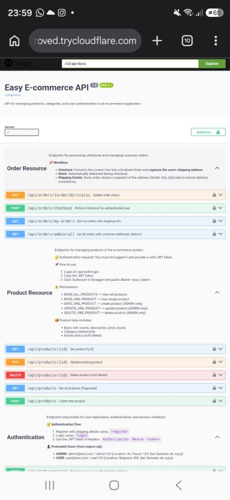

* **URL de Acceso Cifrada:** `https://replication-consciousness-solo-proved.trycloudflare.com/swagger-ui/index.html`
* **Protocolo Verificado:** HTTPS / TLS 1.3 con candado de seguridad validado por el navegador móvil.
* **Componentes Verificados:** Endpoints de autenticación, productos paginados, gestión de carritos y checkout de órdenes cargando en tiempo real desde el backend local.

---

## 6. Capítulo IV: Ciberseguridad, Auditoría DAST y Remediación de Código (Punto 14)

### 6.1 Metodología de Evaluación Aplicada (DAST + White-Box)
En el marco del **Punto 14 (Buenas prácticas de desarrollo seguro y análisis estático)**, se ejecutó una auditoría integral combinando:
1. **Revisión Estática de Código Fuente (White-Box Review):** Inspección exhaustiva de controladores, entidades JPA, servicios y clases de seguridad (`HttpSecurityCode.java`, `JwtConfig.java`).
2. **Pruebas Dinámicas de Seguridad en Aplicaciones (DAST):** Simulación de ataques reales mediante **Burp Suite Community Edition (v2024.x)** desde una máquina atacante virtualizada (Ubuntu Linux) dirigida contra el servidor anfitrión (`192.168.56.1:8081`).

### 6.2 Matriz Sinóptica de Vulnerabilidades Encontradas y Corregidas

| ID | Vulnerabilidad Identificada | Severidad CVSS v3.1 | Clasificación OWASP API | Estado Final |
|:---|:---|:---|:---|:---|
| **VULN-001** | BOLA / IDOR en Endpoint de Vaciado de Carrito (`DELETE /api/cart/clear/{userId}`) | **ALTA (7.5)** | **API1:2023** – Broken Object Level Authorization | **REMEDIADO Y VERIFICADO** |
| **VULN-002** | BOLA / IDOR en Checkout de Pedidos con Fuga de PII y Descuento Ilícito de Stock | **ALTA (8.1)** | **API1:2023** – Broken Object Level Authorization / CWE-359 | **REMEDIADO Y VERIFICADO** |
| **VULN-003** | Exposición Pública No Autenticada de Endpoints de Diagnóstico y Telemetría (`/actuator/**`) | **MEDIA (5.3)** | **API8:2023** – Security Misconfiguration / CWE-200 | **REMEDIADO Y VERIFICADO** |
| **VULN-004** | BOLA / IDOR en Modificación Arbitraria de Ítems del Carrito (`PUT /api/cart/item/{cartItemId}`) | **ALTA (7.5)** | **API1:2023** – Broken Object Level Authorization | **REMEDIADO Y VERIFICADO** |
| **VULN-005** | Consumo Descontrolado de Memoria (DoS) por Listados Masivos No Paginados (`GET /api/products`) | **MEDIA (5.3)** | **API4:2023** – Unrestricted Resource Consumption / CWE-770 | **REMEDIADO Y VERIFICADO** |
| **VULN-006** | Ausencia de Cabeceras de Seguridad HTTP Defensivas (HSTS, CSP, Referrer, Permissions) | **MEDIA (4.3)** | **API8:2023** – Security Misconfiguration / CWE-16 | **REMEDIADO Y VERIFICADO** |

---

### 6.3 Detalle Técnico de Vulnerabilidades, Explotación y Remediación

#### 🔴 VULN-001: BOLA / IDOR en Vaciado de Carrito (`DELETE /api/cart/clear/{userId}`)
* **Vulnerabilidad:** El controlador aceptaba el identificador del usuario como un parámetro en la URL (`@PathVariable Long userId`). Aunque Spring Security validaba que el token JWT fuera auténtico y tuviera la autoridad `CLEAR_CART`, **nunca verificaba que el `userId` de la URL coincidiera con el usuario autenticado**.
* **Impacto:** Cualquier usuario común podía vaciar los carritos de compra de todos los demás clientes y administradores del e-commerce.
* **Evidencia Visual en Burp Suite:**
  
  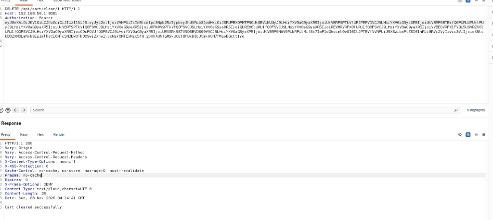
  
  *El usuario atacante (`user@test.com`, ID 2) envió una solicitud `DELETE /api/cart/clear/1`, recibiendo `200 OK: Cart cleared successfully` y vaciando el carrito del Administrador.*
* **Código Remediado:**
  Se agregó el endpoint seguro sin parámetros de ruta en [`CartController.java`](../src/main/java/com/fabrizio/easyecommerce/controller/CartController.java):
  ```java
  @Operation(summary = "Clear current user's cart")
  @PreAuthorize("hasAuthority('CLEAR_CART')")
  @DeleteMapping("/clear")
  public ResponseEntity<String> clearMyCart() {
      CartResponseDTO cart = cartService.getMyCart();
      cartService.clearCart(cart.getUserId());
      return ResponseEntity.status(HttpStatus.OK).body("Cart cleared successfully");
  }
  ```

---

#### 🔴 VULN-002: BOLA / IDOR en Checkout con Fuga de PII y Descuento de Stock
* **Vulnerabilidad:** El endpoint `POST /api/orders/checkout/{userId}` procesaba el pedido del ID especificado en la ruta. Además de descontar el inventario de la tienda sin el consentimiento del titular, la respuesta retornaba el DTO completo de la orden con los datos personales del usuario víctima.
* **Impacto:** Exfiltración masiva de información confidencial (PII) que viola normativas de protección de datos personales y sabotaje del inventario físico.
* **Evidencia Visual en Burp Suite:**
  
  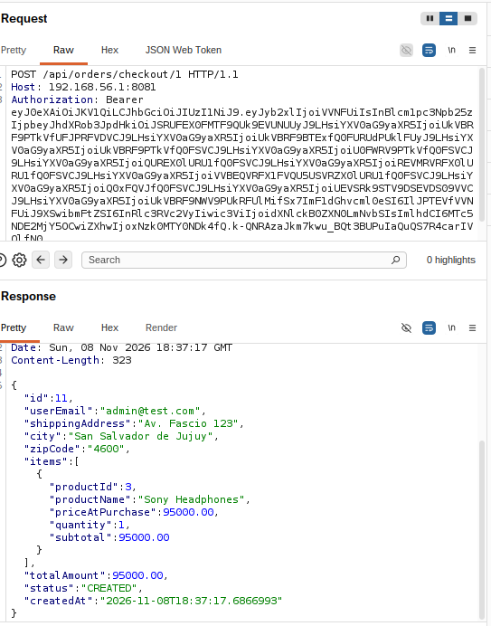
* **Código Remediado:**
  Se incorporó el checkout por contexto de sesión en [`OrderController.java`](../src/main/java/com/fabrizio/easyecommerce/controller/OrderController.java):
  ```java
  @Operation(summary = "Perform Checkout for authenticated user")
  @PreAuthorize("hasAuthority('PERFORM_CHECKOUT')")
  @PostMapping("/checkout")
  public ResponseEntity<OrderResponseDTO> checkout(Authentication authentication) {
      String email = authentication.getName();
      OrderResponseDTO response = orderService.performCheckoutByEmail(email);
      return ResponseEntity.status(HttpStatus.CREATED).body(response);
  }
  ```

---

#### 🟡 VULN-003: Exposición Pública No Autenticada de Actuator (`/actuator/**`)
* **Vulnerabilidad:** En [`HttpSecurityCode.java`](../src/main/java/com/fabrizio/easyecommerce/configSecurity/HttpSecurityCode.java), la regla `authConfig.requestMatchers(..., "/actuator/**").permitAll();` dejaba al descubierto toda la telemetría sin solicitar credenciales.
* **Evidencia Visual en Burp Suite:**
  
  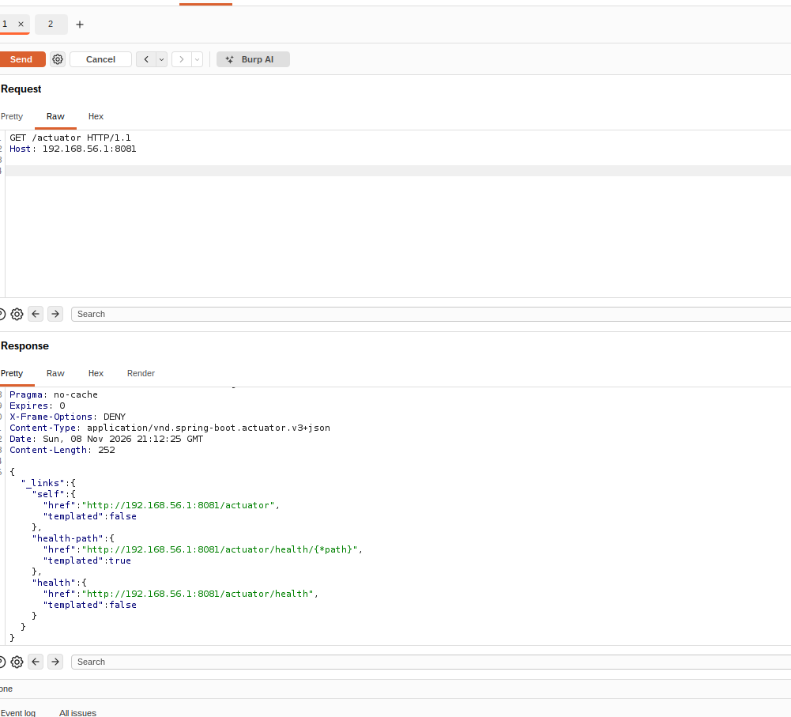
* **Código Remediado:**
  Se blindó la configuración dejando únicamente el sondeo `/actuator/health` público para sondas de liveness de balanceadores:
  ```java
  authConfig.requestMatchers(HttpMethod.GET, "/actuator/health").permitAll();
  authConfig.requestMatchers("/actuator/**").hasRole("ADMINISTRATOR");
  ```

---

#### 🔴 VULN-004: BOLA / IDOR en Modificación Arbitraria de Ítems del Carrito
* **Vulnerabilidad:** El endpoint `PUT /api/cart/item/{cartItemId}?quantity=X` actualizaba la cantidad basándose exclusivamente en el ID numérico de la fila sin verificar titularidad.
* **Evidencia Visual en Burp Suite:**
  
  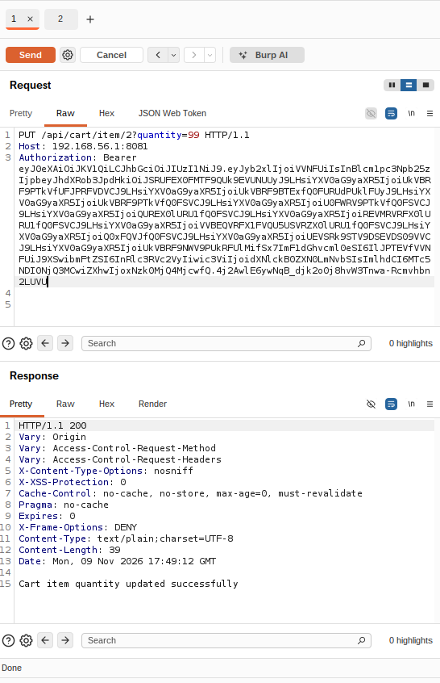
  
  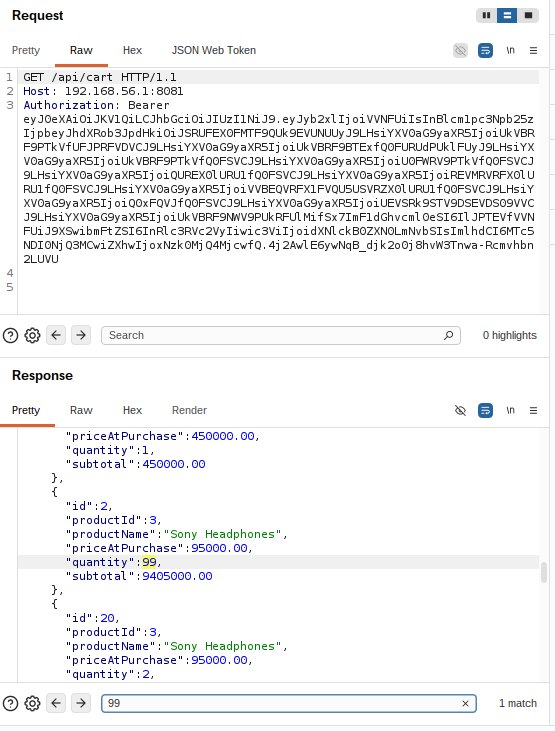
* **Código Remediado:**
  Se implementó validación contextual de pertenencia en [`CartServiceImpl.java`](../src/main/java/com/fabrizio/easyecommerce/Service/cart/CartServiceImpl.java):
  ```java
  String currentEmail = SecurityContextHolder.getContext().getAuthentication().getName();
  CartItem item = cartItemRepository.findById(cartItemId)
          .orElseThrow(() -> new CartNotFoundException("Cart item not found"));

  if (!item.getCart().getUser().getEmail().equals(currentEmail)) {
      throw new AccessDeniedException("No tienes autorización para modificar un ítem de otro usuario");
  }
  ```

---

#### 🟡 VULN-005: Consumo Descontrolado de Recursos / DoS en Catálogo de Productos
* **Vulnerabilidad:** El método `getAllProducts()` ejecutaba un `findByActive(true)` que leía la tabla de productos completa a memoria RAM sin controles de paginación `Pageable`.
* **Evidencia Visual en Burp Suite:**
  
  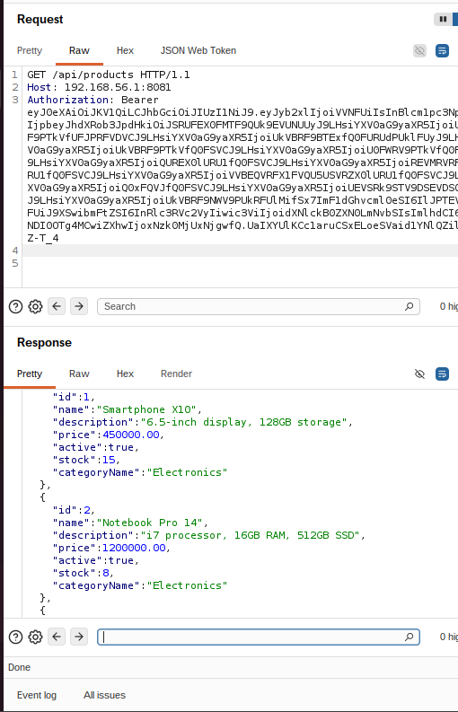
* **Código Remediado:**
  Se introdujo paginación defensiva estándar con Spring Data en [`ProductController.java`](../src/main/java/com/fabrizio/easyecommerce/controller/ProductController.java) con tamaño de página acotado (`size = 20` por defecto):
  ```java
  @Operation(summary = "Get all products (Paginated)")
  @GetMapping
  public ResponseEntity<Page<ProductResponseDTO>> getAllProducts(
          @PageableDefault(page = 0, size = 20, sort = "name") Pageable pageable) {
      Page<ProductResponseDTO> products = productService.getAllProducts(pageable);
      return ResponseEntity.status(HttpStatus.OK).body(products);
  }
  ```

---

#### 🟡 VULN-006: Ausencia de Cabeceras de Seguridad HTTP Defensivas
* **Vulnerabilidad:** El servidor web no incluía directivas de seguridad en sus encabezados de respuesta HTTP, exponiendo a ataques de intermediación (MitM) y degradación de transporte.
* **Evidencia Visual en Burp Suite:**
  
  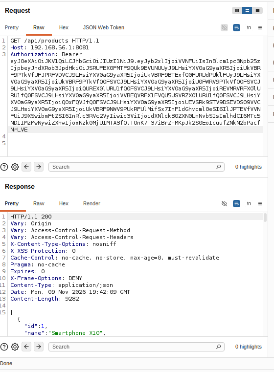
* **Código Remediado:**
  Se configuró el bloque `http.headers(...)` en el `SecurityFilterChain` de [`HttpSecurityCode.java`](../src/main/java/com/fabrizio/easyecommerce/configSecurity/HttpSecurityCode.java):
  ```java
  http.headers(headers -> headers
      .httpStrictTransportSecurity(hsts -> hsts
          .includeSubDomains(true)
          .maxAgeInSeconds(31536000)
      )
      .contentSecurityPolicy(csp -> csp
          .policyDirectives("default-src 'self'; frame-ancestors 'none';")
      )
      .referrerPolicy(referrer -> referrer
          .policy(ReferrerPolicyHeaderWriter.ReferrerPolicy.STRICT_ORIGIN_WHEN_CROSS_ORIGIN)
      )
      .permissionsPolicy(permissions -> permissions
          .policy("geolocation=(), microphone=(), camera=()")
      )
  );
  ```

---

### 6.4 Matriz de Verificación y Pruebas Unitarias de Regresión
Para garantizar que las remediaciones no quebraron la funcionalidad existente, se ejecutó la suite completa de pruebas automatizadas:

```bash
./mvnw -B test
```

```text
[INFO] Results:
[INFO] 
[INFO] Tests run: 45, Failures: 0, Errors: 0, Skipped: 0
[INFO] 
[INFO] ------------------------------------------------------------------------
[INFO] BUILD SUCCESS
[INFO] ------------------------------------------------------------------------
```

* **Servicio y Controlador de Carrito (`CartControllerTest` / `CartServiceImplTest`):** 9 tests en controlador y tests de servicio validando inserciones, cálculo de subtotales, rechazo de cantidades inválidas, autorización y el vaciado contextual seguro.
* **Servicio y Controlador de Órdenes (`OrderControllerTest` / `OrderServiceImplTest`):** Tests validando checkout transaccional seguro y lectura de pedidos.
* **Servicio y Controlador de Productos (`ProductControllerTest` / `ProductServiceImplTest`):** Tests validando paginación con `Pageable`, CRUD y borrado lógico.
* **Servicio de Autenticación (`AuthenticationControllerTest` / `AuthServiceImplTest`):** Tests verificando emisión de tokens JWT, hashing con BCrypt y rechazo de credenciales incorrectas.
* **Controlador de Categorías (`CategoryControllerTest`):** Tests validando altas, bajas y actualización mediante `PUT`.

---

## 7. Capítulo V: Unificación del Frontend SPA y Proxy Inverso Nginx

La aplicación cliente construida en **React 19 + Vite** fue integrada al repositorio principal dentro del directorio [`frontend/`](../frontend).

### 7.1 Configuración de Nginx y Enrutamiento (`nginx.conf`)
Para evitar problemas de CORS y centralizar las peticiones en un solo dominio, el contenedor de Frontend utiliza Nginx actuando simultáneamente como servidor web de estáticos y como **Proxy Inverso** hacia el Backend Spring Boot (`http://app:8081`):

```nginx
server {
    listen 80;
    server_name localhost;

    # Proxy inverso transparente hacia el backend
    location /api/        { proxy_pass http://app:8081; }
    location /products/   { proxy_pass http://app:8081/api/products/; }
    location = /products  { proxy_pass http://app:8081/api/products; }
    location /categories/ { proxy_pass http://app:8081/api/categories/; }
    location = /categories{ proxy_pass http://app:8081/api/categories; }
    location /cart/       { proxy_pass http://app:8081/api/cart/; }
    location = /cart      { proxy_pass http://app:8081/api/cart; }
    location /orders/     { proxy_pass http://app:8081/api/orders/; }
    location = /orders    { proxy_pass http://app:8081/api/orders; }
    location /auth/       { proxy_pass http://app:8081/api/auth/; }

    # Enrutamiento SPA con React Router
    location / {
        root /usr/share/nginx/html;
        index index.html index.htm;
        try_files $uri $uri/ /index.html;
    }
}
```

### 7.2 Optimización de Imagen Docker (`frontend/.dockerignore`)
Se configuró un archivo `.dockerignore` estricto que excluye `node_modules`, `dist` y archivos de log, reduciendo la transferencia del contexto de compilación de **95 MB a menos de 1 MB**.

### 7.3 Credenciales Preconfiguradas para Pruebas
Gracias a la incorporación de la extensión criptográfica `pgcrypto` en el script de carga masiva (`02-load-easycommerce-dataset.sql`), el sistema cuenta con cuentas listas para iniciar sesión de inmediato:
* **Administrador:** `admin@test.com` / `admin123` (Rol: `ADMINISTRATOR`).
* **Cliente:** `user@test.com` / `user123` (Rol: `USER`).

---

## 8. Capítulo VI: Documentación de la API (OpenAPI 3.1 & Swagger UI)

El contrato de la API REST fue formalizado bajo el estándar **OpenAPI 3.1**:

* **Exportación del Contrato JSON:** Disponible en [`docs/openapi_spec.json`](openapi_spec.json) con todos los recursos del sistema documentados:
  * `Authentication`: Registro, Login y validación de perfil (`/api/auth/**`).
  * `Product Resource`: Catálogo paginado, búsqueda por ID, altas, modificaciones y bajas lógicas (`/api/products/**`).
  * `Category Resource`: Listados y administración de categorías (`/api/categories/**`).
  * `Cart Resource`: Consulta de carrito, adición de ítems, actualización de cantidades y vaciado seguro (`/api/cart/**`).
  * `Order Resource`: Checkout transaccional y consulta de pedidos (`/api/orders/**`).
* **Swagger UI Interactivo:** Accesible en red local y a través del túnel HTTPS en:
  ```
  https://<dominio-cloudflare>/swagger-ui/index.html
  ```
* **Telemetría y Salud:** Endpoint seguro de liveness probe disponible en:
  ```
  https://<dominio-cloudflare>/actuator/health  -->  {"status":"UP"}
  ```

---

## 9. Capítulo VII: Conclusiones y Cumplimiento de Puntos de la Cátedra

El trabajo realizado consolida un estándar de calidad y seguridad industrial sobre la plataforma `easyecommerce`, cumpliendo de manera demostrable con las exigencias de la cátedra:

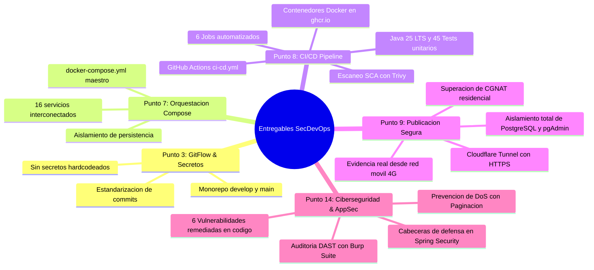

### Síntesis de Entregables Disponibles en Repositorio:
* 📄 **Informe Técnico Integrador:** [`docs/INFORME_TECNICO_INTEGRADOR_SECDEVOPS_HIA.md`](INFORME_TECNICO_INTEGRADOR_SECDEVOPS_HIA.md)
* 📜 **Especificación OpenAPI 3.1:** [`docs/openapi_spec.json`](openapi_spec.json)
* 📸 **Banco de Evidencias Fotográficas:**
  * Acceso móvil celular: [`docs/imagenes/evidencia_acceso_remoto_celular.jpg`](imagenes/evidencia_acceso_remoto_celular.jpg)
  * Vulnerabilidades Burp Suite: [`docs/imagenes/vuln001_bola_cart_clear.png`](imagenes/vuln001_bola_cart_clear.png) a [`docs/imagenes/vuln006_missing_security_headers.png`](imagenes/vuln006_missing_security_headers.png)
* ⚙️ **Workflow de Integración Continua (6 Jobs):** [`.github/workflows/ci-cd.yml`](../.github/workflows/ci-cd.yml)
* 🐳 **Orquestación Completa de Infraestructura:** [`infrastructure/docker-compose.yml`](../infrastructure/docker-compose.yml)
* 🐳 **Dockerfiles Multi-Stage:** [`Dockerfile`](../Dockerfile) y [`frontend/Dockerfile`](../frontend/Dockerfile)
