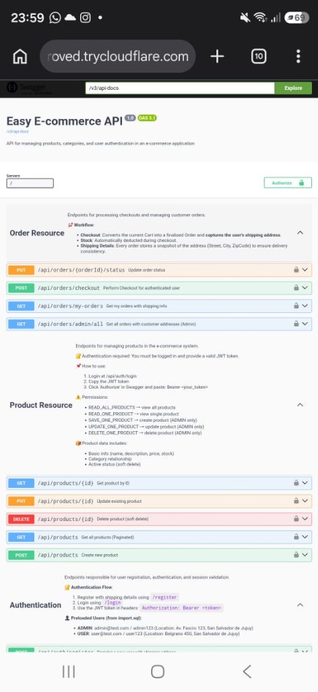

# 🌐 Punto 9: Publicación Segura en Internet con Cloudflare Tunnel & HTTPS
## Trabajo Práctico Final Integrador – Herramientas Informáticas Avanzadas (HIA) - APU
### Responsable: Miembro 1 (SecDevOps & AppSec Lead)
### Proyecto: `easyecommerce` (Backend Spring Boot 3.5.3 + PostgreSQL + Docker)

---

## 1. 🎯 Objetivos del Requerimiento

Según las pautas oficiales de la cátedra para el **Punto 9**:
1. **Publicación Externa Segura:** Exponer la aplicación a Internet mediante una herramienta de túnel seguro (**Cloudflare Tunnel** / Tailscale Funnel) con certificados SSL/TLS válidos (**HTTPS**) para acceso remoto y defensa del proyecto.
2. **Aislamiento de Infraestructura Interna:** Garantizar que los servicios críticos de almacenamiento de datos (**PostgreSQL 5432**) y herramientas de gestión administrativa (**pgAdmin 5050**) queden **estrictamente aislados** de la red pública, cumpliendo el principio de menor exposición y menor privilegio.
3. **Mitigación de Amenazas de Red:** Ocultar la dirección IP pública real del servidor origen, mitigando ataques directos, escaneos de puertos y denegación de servicio (DDoS).

---

## 2. 🏛️ Arquitectura de Red y Flujo de Tráfico

El siguiente diagrama ilustra cómo fluyen las peticiones desde clientes externos (usuarios, evaluadores y dispositivos móviles) hacia la aplicación:

```mermaid
flowchart LR
    subgraph WAN["Internet Pública"]
        ClientMobile["📱 Cliente Móvil (4G/5G)"]
        Evaluator["💻 Evaluadores / Cátedra"]
    end

    subgraph CF["Cloudflare Edge Anycast"]
        CF_SSL["Proxy Inverso HTTPS / TLS 1.3\nCertificado SSL Válido"]
        CF_DDoS["Protección DDoS & WAF"]
    end

    subgraph Host["Host Local (Windows / Docker Desktop)"]
        CFTunnel["🚇 cloudflared Daemon\n(Túnel saliente cifrado)"]
        
        subgraph AppZone["Zona de Aplicación (Expuesta por Túnel)"]
            Backend["☕ Backend Spring Boot\n(Puerto 8081)"]
            Swagger["📑 Swagger UI / OpenAPI 3.1\n(/swagger-ui/index.html)"]
        end

        subgraph PrivateZone["Zona Aislada (Estrictamente Privada)"]
            DB[("🐘 PostgreSQL 15\n(Puerto 5432 - NO EXPUESTO)")]
            PgAdmin["📊 pgAdmin 4\n(Puerto 5050 - NO EXPUESTO)")]
        end
    end

    ClientMobile -->|HTTPS :443| CF_SSL
    Evaluator -->|HTTPS :443| CF_SSL
    CF_SSL --> CF_DDoS
    CF_DDoS <==|Túnel Seguro QUIC / HTTP/2|==> CFTunnel
    CFTunnel -->|HTTP :8081| Backend
    Backend -.->|Conexión JDBC Interna| DB
```

> [!IMPORTANT]
> **Aislamiento de Red:** El daemon de Cloudflare (`cloudflared`) solo enruta el tráfico destinado al puerto `8081` (Spring Boot). Los puertos `5432` (PostgreSQL) y `5050` (pgAdmin) no forman parte del túnel ni poseen reglas de mapeo público, por lo que resulta técnicamente imposible acceder a la base de datos desde Internet.

---

## 3. ⚙️ Justificación Técnica: ¿Por qué Cloudflare Tunnel?

1. **Superación de CGNAT:** La mayoría de los proveedores de internet residenciales (ISP) en Argentina implementan *Carrier-Grade NAT*, impidiendo el port forwarding tradicional hacia routers locales. Cloudflare Tunnel inicia una conexión **saliente** (outbound) cifrada hacia los centros de datos de Cloudflare, resolviendo este problema sin abrir puertos en el módem.
2. **Cifrado TLS de Extremo a Extremo:** Cloudflare termina la conexión HTTPS en el Edge con certificados SSL/TLS emitidos por autoridades certificadoras reconocidas mundialmente, eliminando advertencias de "Sitio no seguro".
3. **Cero Exposición de IP:** La IP de la máquina anfitriona nunca se revela; los registros DNS de `trycloudflare.com` apuntan a la infraestructura Anycast de Cloudflare.

---

## 4. 🚀 Guía de Puesta en Marcha y Comandos

### Opción A: Ejecución Directa en Windows (PowerShell)
El ejecutable oficial `cloudflared.exe` se encuentra disponible en `tools/cloudflared.exe`.

1. Asegurar que PostgreSQL y el Backend de Spring Boot se encuentren en ejecución (puerto `8081`).
2. Abrir PowerShell en la raíz del proyecto y ejecutar:
   ```powershell
   & "C:\Users\danip\Desktop\HIA\tp_final\tools\cloudflared.exe" tunnel --url http://localhost:8081
   ```
3. Cloudflare generará un subdominio efímero con protocolo HTTPS (ej. `https://xxxx.trycloudflare.com`).

### Opción B: Ejecución en Docker Compose (Servicio de Infraestructura)
Para entornos de integración continua o producción, se puede orquestar mediante el contenedor oficial:
```yaml
services:
  cloudflare-tunnel:
    image: cloudflare/cloudflared:latest
    container_name: easycommerce-tunnel
    restart: unless-stopped
    command: tunnel --url http://easycommerce-app:8081
    networks:
      - easycommerce-network
```

---

## 5. 📸 Evidencias Empíricas de Funcionamiento

### Acceso Exitoso desde Red Móvil Externa (Celular 4G/5G)
Como prueba de fuego de la publicación a Internet, un miembro del equipo se conectó desde un dispositivo móvil a través de su red de datos móviles (fuera de la red local WiFi):



* **URL de acceso:** `https://replication-consciousness-solo-proved.trycloudflare.com/swagger-ui/index.html`
* **Protocolo:** HTTPS (Cifrado con candado verde).
* **Servicio:** Swagger UI cargando la documentación interactiva OpenAPI 3.1 de la API `Easy E-commerce API 1.0`.

---

## 6. 📑 Documentación de la API (OpenAPI 3.1 & Swagger UI)

El backend de `easyecommerce` expone su contrato de interfaz de forma estandarizada:

* **Especificación OpenAPI (JSON):** Exportada localmente en [`docs/openapi_spec.json`](openapi_spec.json) con los 17 endpoints del sistema (Autenticación, Productos paginados, Categorías, Carrito y Órdenes).
* **Documentación Interactiva (Swagger UI):** Accesible en tiempo de ejecución en la ruta `/swagger-ui/index.html`.
* **Health Check de Actuator:** Accesible en `/actuator/health` retornando `{"status":"UP"}`.
