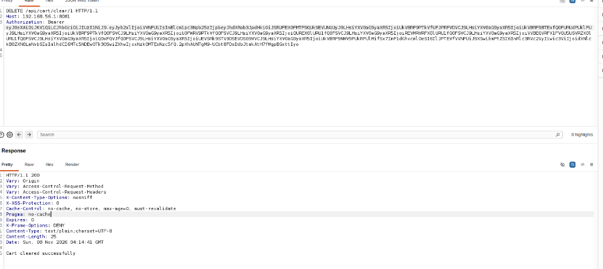
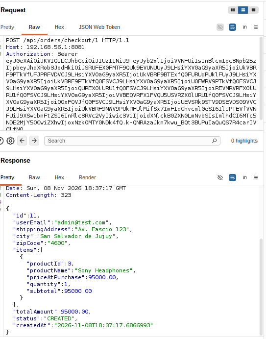
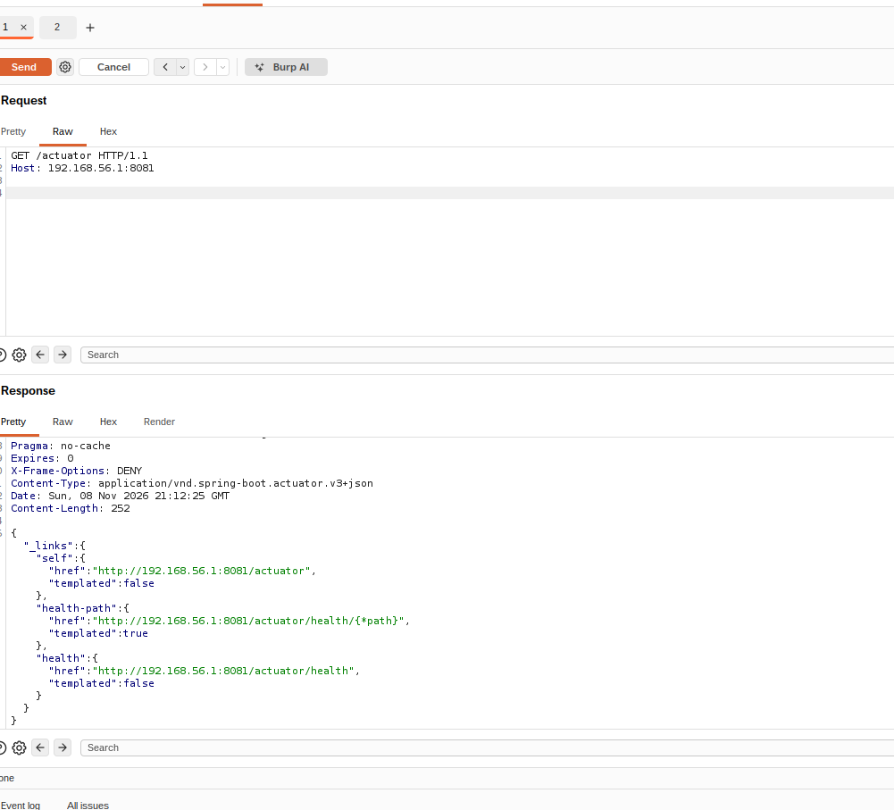
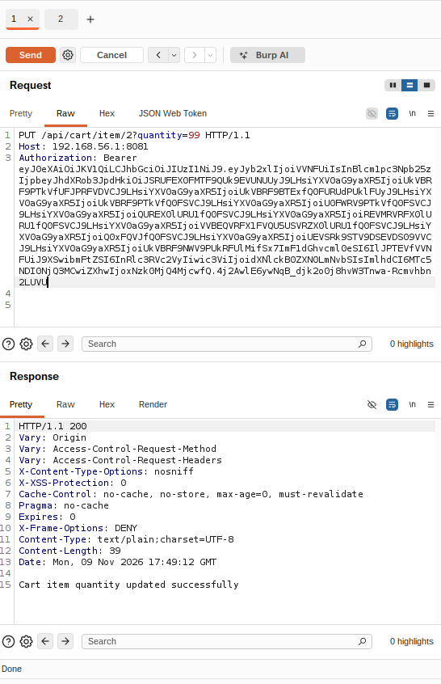
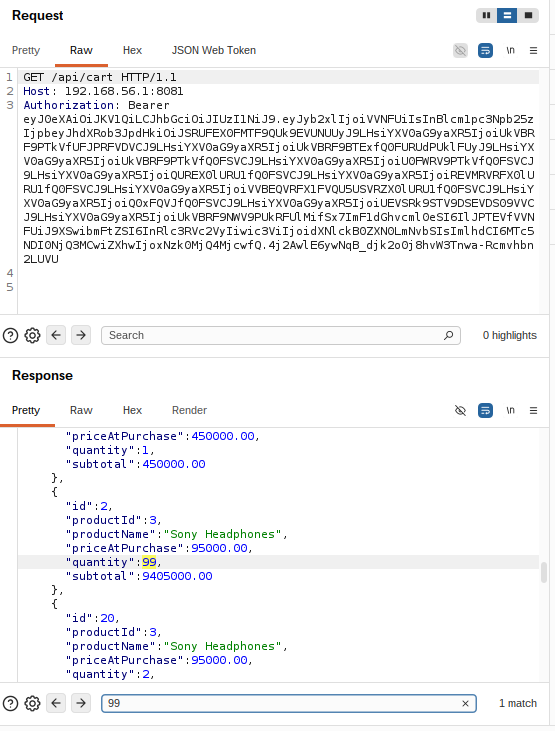
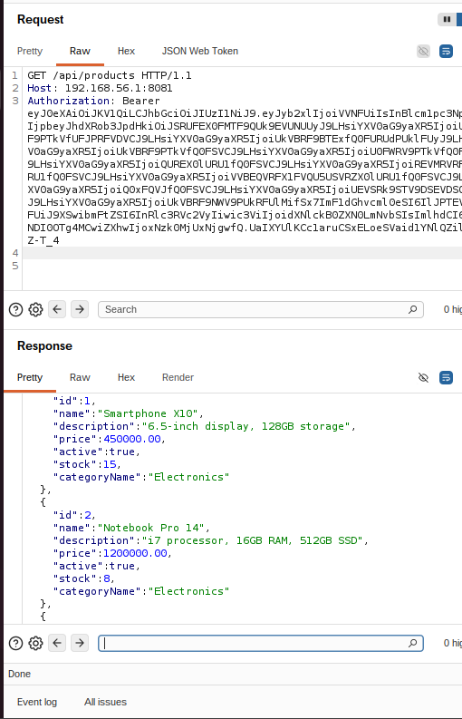
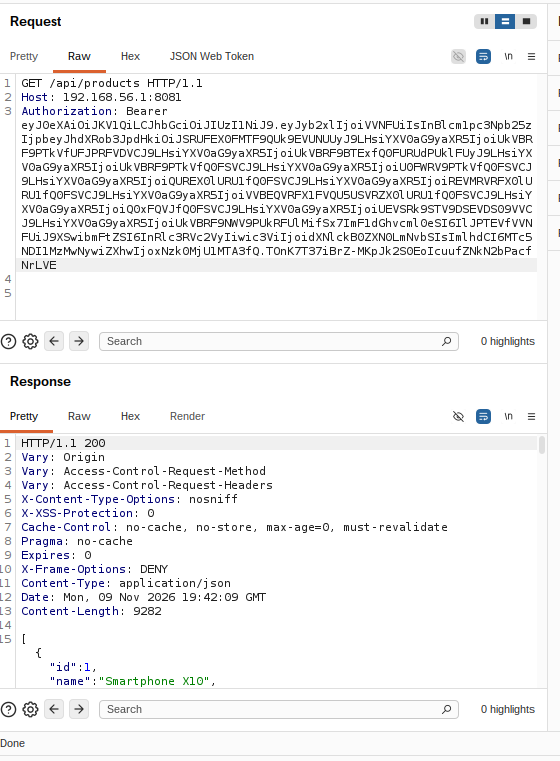

# 🛡️ Informe de Auditoría de Seguridad de Aplicaciones (AppSec Assessment Report)
## Trabajo Práctico Final Integrador – Herramientas Informáticas Avanzadas (HIA) - APU
### Punto 14: Buenas Prácticas de Desarrollo Seguro y Análisis Estático

**Proyecto Auditado:** `easyecommerce` (Plataforma E-Commerce Backend REST API)  
**Componentes Evaluados:** Backend Spring Boot API (`com.fabrizio.easyecommerce`)  
**Tipo de Evaluación:** Auditoría de Caja Blanca / White-Box (Revisión Estática de Código Fuente + DAST Asistido)  
**Acceso al Código Fuente:** Sí (Acceso irrestricto al repositorio Git en rama `develop`, archivos de configuración `application.yml`, scripts `import.sql`, controladores, servicios, modelos y configuración de seguridad)  
**Período de Ejecución:** 8 de Noviembre de 2026 – 9 de Noviembre de 2026  
**Fecha de Consolidación:** 9 de Noviembre de 2026  
**Auditor Responsable:** Estudiante APU / Auditor AppSec Junior  
**Audiencia Objetivo:** Desarrolladores Backend, Evaluadores de Cátedra HIA, Arquitectos de Software  

---

## 📌 1. Resumen Ejecutivo de Hallazgos

En el marco del **Punto 14 (Buenas prácticas de desarrollo seguro y análisis estático)** del Trabajo Práctico Final de *Herramientas Informáticas Avanzadas*, se llevó a cabo una auditoría integral de seguridad de aplicaciones (AppSec) sobre el backend del sistema `easyecommerce`. 

La evaluación combinó técnicas de **revisión estática de código fuente (White-Box Code Review)** sobre el framework Spring Boot 3 con **pruebas de penetración dinámicas (DAST)** ejecutadas mediante herramientas especializadas de interceptación HTTP (Burp Suite Community Edition).

A continuación se resume el estado final de vulnerabilidades identificadas y comprobadas empíricamente contra el entorno en ejecución:

| ID | Vulnerabilidad | Severidad (CVSS v3.1) | Categoría OWASP | Estado | Fecha Detección |
|:---|:---|:---|:---|:---|:---|
| **VULN-001** | Control de Acceso Roto a Nivel de Objeto (BOLA / IDOR) en la Operación de Vaciado de Carrito | **ALTA (7.5)** | **API1:2023** – Broken Object Level Authorization / CWE-639 | Confirmada con Evidencia Visual | 08/11/2026 |
| **VULN-002** | BOLA / IDOR en Proceso de Checkout con Exfiltración de Datos Personales (PII) y Afectación de Stock | **ALTA (8.1)** | **API1:2023** – Broken Object Level Authorization / CWE-639 / CWE-359 | Confirmada con Evidencia Visual | 08/11/2026 |
| **VULN-003** | Exposición Pública No Autenticada de Endpoints de Observabilidad y Monitoreo Interno (`/actuator/**`) | **MEDIA (5.3)** | **API8:2023** – Security Misconfiguration / CWE-200 / A05:2021 | Confirmada con Evidencia Visual | 09/11/2026 |
| **VULN-004** | BOLA / IDOR en Manipulación y Modificación Arbitraria de Ítems del Carrito (`PUT /api/cart/item/{cartItemId}`) | **ALTA (7.5)** | **API1:2023** – Broken Object Level Authorization / CWE-639 | Confirmada con Evidencia Visual | 09/11/2026 |
| **VULN-005** | Consumo Descontrolado de Recursos por Ausencia de Paginación en Endpoints de Catálogo (`GET /api/products`) | **MEDIA (5.3)** | **API4:2023** – Unrestricted Resource Consumption / CWE-770 | Confirmada con Evidencia Visual | 09/11/2026 |
| **VULN-006** | Ausencia de Cabeceras de Seguridad HTTP Defensivas (HSTS, CSP, Referrer-Policy) en Respuestas del Backend | **MEDIA (4.3)** | **API8:2023** – Security Misconfiguration / CWE-16 / A05:2021 | Confirmada con Evidencia Visual | 09/11/2026 |

---

## 🧭 2. Metodología de Auditoría Utilizada

El procedimiento de evaluación se rigió bajo los estándares de la industria en seguridad web y de APIs:
* **OWASP Web Security Testing Guide (WSTG v4.2)**.
* **OWASP API Security Top 10 (2023)**.
* **CWE (Common Weakness Enumeration)**.

### Fases de la Metodología Aplicada:
```
[ 1. Mapeo y Arquitectura ] ──> [ 2. Análisis Estático (Caja Blanca) ] ──> [ 3. Explotación Dinámica (DAST) ] ──> [ 4. Causa Raíz e Impacto ] ──> [ 5. Especificaciones de Remediación ]
  • Endpoints y Seguridad           • Inspección de Controllers/Services      • Interceptación con Burp Suite          • Análisis de Lógica de Negocio    • Especificaciones en /specs_seguridad
  • Dependencias (pom.xml)          • Verificación de Autorizaciones          • Peticiones HTTP manipuladas            • Evidencia Irrefutable (Prints)   • Plan de Parcheo en Código
```

---

## 🖥️ 3. Entorno de Pruebas, Infraestructura y Topología

Para realizar una auditoría realista y aislada, se utilizó un entorno de pruebas multi-segmentado compuesto por una máquina atacante virtualizada y el servidor anfitrión:

```
┌────────────────────────────────────────────────────────┐
│ MÁQUINA ATACANTE (Entorno de Auditoría AppSec)         │
│ • S.O.: Ubuntu Linux (VirtualBox VM)                   │
│ • Herramientas: Burp Suite Community Edition v2024.x    │
│ • Interfaz: Red Host-Only / Adaptador de Red Virtual   │
└───────────────────────────┬────────────────────────────┘
                            │
                            │ Tráfico HTTP / REST (Puerto 8081)
                            ▼
┌────────────────────────────────────────────────────────┐
│ MÁQUINA OBJETIVO (Servidor Anfitrión)                  │
│ • S.O. Host: Windows 11                                │
│ • IP de Acceso Host-Only: 192.168.56.1                 │
│ • Backend: Spring Boot 3.5.3 (Java 25) escuchando en   │
│   http://192.168.56.1:8081                             │
│ ┌────────────────────────────────────────────────────┐ │
│ │ Capa de Persistencia Local                         │ │
│ │ • PostgreSQL 15 escuchando en 127.0.0.1:5432       │ │
│ │ • Base de Datos: easyecommerce                     │ │
│ │ • Inicialización: import.sql (Datos de prueba)     │ │
│ └────────────────────────────────────────────────────┘ │
└────────────────────────────────────────────────────────┘
```

---

## 🧰 4. Herramientas Utilizadas

1. **Burp Suite Community Edition**:
   * *Repeater*: Modificación manual de cabeceras HTTP, manipulación de Bearer Tokens e inyección de identificadores en rutas REST.
2. **PostgreSQL 15 (Local)**:
   * Servidor de base de datos relacional para persistencia de usuarios, carritos, productos y pedidos.
3. **Spring Boot DevTools & Logs**:
   * Trazabilidad en tiempo real de excepciones y eventos generados en el servidor ante peticiones no autorizadas.
4. **Git**:
   * Control de versiones para inspección de código fuente en la rama `develop`.

---

## 📦 5. Alcance Detallado y Análisis de Dependencias (SCA)

### 5.1 Componentes Evaluados
* **Controladores analizados:** `AuthenticationController`, `CartController`, `CategoryController`, `OrderController`, `ProductController`.
* **Configuración de Seguridad:** `HttpSecurityCode`, `JwtAuthenticationFilter`, `JwtConfig`, `SecurityBeanInyector`.
* **Servicios de Negocio:** Servicios de carrito (`CartServiceImpl`), órdenes (`OrderServiceImpl`), autenticación y productos.

### 5.2 Revisión de Dependencias (Software Component Analysis - SCA)
Analizado desde [`pom.xml`](pom.xml):

| Dependencia | Versión Declarada | Propósito | Evaluación de Seguridad |
|:---|:---|:---|:---|
| `spring-boot-starter-web` | 3.5.3 (Parent) | API REST MVC | Versión reciente; soporte activo. |
| `spring-boot-starter-security` | 3.5.3 (Parent) | Autenticación y Autorización | Provee filtros y context holder. Configuración susceptible a errores lógicos en SpEL. |
| `spring-boot-starter-validation`| 3.5.3 (Parent) | Validación Jakarta (`@Valid`) | Integrado en DTOs de entrada. |
| `spring-boot-starter-actuator` | 3.5.3 (Parent) | Diagnóstico y Métricas | Expuesto indebidamente a clientes anónimos (`permitAll`). |
| `micrometer-registry-prometheus`| Parent | Exportación de Métricas | Dependencia operativa; requiere protección de acceso. |
| `jjwt-api`, `jjwt-impl`, `jjwt-jackson` | 0.11.5 | Generación y firmado de JWTs | Librería estándar. El secret key debe protegerse fuera del código. |
| `postgresql` | Runtime (Parent) | Driver JDBC | Correcto. |

---

## 🔍 6. Detalle Exhaustivo de Vulnerabilidades

---

### VULN-001: Control de Acceso Roto a Nivel de Objeto (BOLA / IDOR) en la Operación de Vaciado de Carrito

* **ID:** VULN-001  
* **Título:** Broken Object Level Authorization (BOLA / IDOR) en Endpoint de Vaciado de Carrito (`DELETE /api/cart/clear/{userId}`)  
* **Severidad:** **ALTA** (CVSS:3.1/AV:N/AC:L/PR:L/UI:N/S:U/C:N/I:H/A:H – Score: 7.5)  
* **Clasificación:** OWASP API Security Top 10 (2023) **API1:2023 – Broken Object Level Authorization** / CWE-639  
* **Fecha de Hallazgo:** 08/11/2026  
* **Estado:** Confirmada / Pendiente de Parcheo en Código  

#### 6.1 Explicación Didáctica para Desarrolladores
En una aplicación de comercio electrónico que utiliza autenticación basada en tokens JWT, la identidad del usuario viaja de manera confiable e inalterable en el encabezado `Authorization: Bearer <TOKEN>`.

El fallo ocurre cuando un endpoint diseñado para modificar recursos privados de un usuario (en este caso, vaciar su carrito de compras) solicita el identificador del usuario como un parámetro en la URL (`@PathVariable Long userId`), en lugar de extraer la identidad directamente del token JWT verificado por Spring Security.

Al mismo tiempo, la anotación de seguridad `@PreAuthorize("hasAuthority('CLEAR_CART')")` solo comprueba que el atacante posea el permiso genérico para vaciar carritos (permiso que ostenta cualquier usuario normal con rol `USER`). **El backend nunca valida si el `userId` provisto en la URL coincide con el identificador del usuario que firmó la petición.**

#### 6.2 Impacto en el Negocio y la Aplicación
* **Denegación de Servicio en Compras:** Un atacante autenticado con una cuenta básica puede automatizar un bucle para vaciar los carritos de todos los usuarios registrados y administradores de la plataforma.
* **Violación de Integridad:** Pérdida de la persistencia de las selecciones de compra de los clientes, afectando negativamente la experiencia de usuario y las ventas del e-commerce.

#### 6.3 Evidencia Visual Irrefutable (DAST)
A través de la herramienta Burp Suite Repeater, se ejecutó una petición con el token JWT legítimo del usuario de prueba `user@test.com` (ID 2), modificando el parámetro de ruta a `userId = 1` (correspondiente al Administrador):



**Análisis de la Evidencia:**
* **Petición del Atacante:** `DELETE /api/cart/clear/1 HTTP/1.1` portando las credenciales de `user@test.com`.
* **Respuesta del Servidor:** `HTTP/1.1 200 OK` con cuerpo `Cart cleared successfully`.
* **Resultado:** El carrito del usuario `1` fue vaciado exitosamente por un tercero sin autorización contextual.

#### 6.4 Análisis de Código Fuente Vulnerable

En [`CartController.java`](file:///C:/Users/danip/Desktop/HIA/tp_final/easyecommerce/src/main/java/com/fabrizio/easyecommerce/controller/CartController.java):
```java
// ⚠️ VULNERABILIDAD: El endpoint recibe userId del cliente y no valida la propiedad del objeto
@PreAuthorize("hasAuthority('CLEAR_CART')")
@DeleteMapping("/clear/{userId}")
public ResponseEntity<String> clearCart(@PathVariable Long userId) {
    logger.info("REST request to clear cart for user ID: {}", userId);
    cartService.clearCart(userId);
    return ResponseEntity.status(HttpStatus.OK).body("Cart cleared successfully");
}
```

En [`CartServiceImpl.java`](file:///C:/Users/danip/Desktop/HIA/tp_final/easyecommerce/src/main/java/com/fabrizio/easyecommerce/Service/cart/CartServiceImpl.java):
```java
@Override
@Transactional
public void clearCart(Long userId) {
    // ⚠️ VULNERABILIDAD: Se recupera y vacía el carrito basado únicamente en el parámetro recibido
    Cart cart = cartRepository.findByUserId(userId).orElseThrow(() -> {
        return new CartNotFoundException("Cart for user with id " + userId + " not found");
    });

    int itemsRemoved = cart.getItems().size();
    cart.getItems().clear();
    cartRepository.save(cart);
}
```

#### 6.5 Remediación Planificada (Código Seguro para Producción)

Para subsanar esta debilidad, se implementará la eliminación del parámetro `{userId}` de la ruta pública de cliente, delegando la extracción de la identidad exclusivamente en el contexto de seguridad autenticado:

**Controlador Seguro (`CartController.java`):**
```java
@Operation(summary = "Clear current user's cart")
@PreAuthorize("hasAuthority('CLEAR_CART')")
@DeleteMapping("/clear")
public ResponseEntity<String> clearMyCart(Authentication authentication) {
    String email = authentication.getName();
    cartService.clearCartByEmail(email);
    return ResponseEntity.status(HttpStatus.OK).body("Cart cleared successfully");
}
```

**Servicio Seguro (`CartServiceImpl.java`):**
```java
@Override
@Transactional
public void clearCartByEmail(String email) {
    Cart cart = cartRepository.findByUserEmail(email).orElseThrow(() -> {
        return new CartNotFoundException("Cart for user " + email + " not found");
    });

    cart.getItems().clear();
    cartRepository.save(cart);
}
```

---

### VULN-002: BOLA / IDOR en Checkout de Pedidos con Exfiltración de Datos Personales (PII) y Afectación de Stock

* **ID:** VULN-002  
* **Título:** Broken Object Level Authorization (BOLA / IDOR) en Proceso de Checkout con Fuga de Información Privada (`POST /api/orders/checkout/{userId}`)  
* **Severidad:** **ALTA** (CVSS:3.1/AV:N/AC:L/PR:L/UI:N/S:U/C:H/I:H/A:L – Score: 8.1)  
* **Clasificación:** OWASP API Security Top 10 (2023) **API1:2023 – Broken Object Level Authorization** / CWE-639 y CWE-359 (Exposición de Datos Personales Sensibles)  
* **Fecha de Hallazgo:** 08/11/2026  
* **Estado:** Confirmada / Pendiente de Parcheo en Código  

#### 6.6 Explicación Didáctica para Desarrolladores
La operación de Checkout es el punto neurálgico del modelo de comercio electrónico: finaliza la compra, captura la dirección física de despacho del cliente y decrementa el inventario de la tienda.

En el diseño actual, el controlador `OrderController` expone el endpoint `/api/orders/checkout/{userId}`. Spring Security evalúa la anotación `@PreAuthorize("hasAuthority('PERFORM_CHECKOUT')")`, permitiendo el acceso ya que cualquier usuario estándar registrado posee dicha autoridad en su JWT. Sin embargo, el método toma ciegamente el `userId` recibido en la URL y ejecuta la lógica de negocio sobre el carrito de ese usuario, sin verificar si el cliente autenticado es el legítimo propietario.

Como consecuencia directa, un atacante no solo puede forzar compras a nombre de otras personas afectando el stock de los productos, sino que el backend responde devolviendo el DTO completo de la orden generada, **exponiendo la dirección de residencia física, localidad, código postal y correo electrónico de la víctima**.

#### 6.7 Impacto en el Negocio y la Aplicación
* **Fuga Masiva de Datos Personales (PII Leakage):** Violación crítica de privacidad. Un atacante con una cuenta básica puede recolectar las direcciones postales reales de todos los clientes y administradores registrados en la plataforma.
* **Manipulación Fraudulenta de Inventario:** Descuento forzado de existencias en el inventario de la tienda (`products.stock` en PostgreSQL) sin consentimiento del titular de la cuenta, provocando desabastecimiento artificial y pedidos fantasma.

#### 6.8 Evidencia Visual Irrefutable (DAST)
A través de Burp Suite Repeater, un usuario autenticado con el rol `USER` (`user@test.com`, ID 2) forzó la ejecución del checkout sobre la cuenta del Administrador (`userId = 1`), recibiendo la confirmación de la orden junto con los datos de envío privados de la víctima:



**Análisis de la Evidencia:**
* **Petición del Atacante:** `POST /api/orders/checkout/1 HTTP/1.1` con el Bearer Token del usuario 2.
* **Respuesta del Servidor:** `HTTP/1.1 201 Created`.
* **Datos Sensibles Exfiltrados:**
  * Correo Electrónico: `userEmail: "admin@test.com"`
  * Domicilio de Envío: `shippingAddress: "Av. Fascio 123"`
  * Localidad: `city: "San Salvador de Jujuy"`
  * Código Postal: `zipCode: "4600"`
  * Total de la Orden Creada: `$95000.00`
  * Disminución de 1 unidad de stock en el producto `"Sony Headphones"`.

#### 6.9 Análisis de Código Fuente Vulnerable

En [`OrderController.java`](file:///C:/Users/danip/Desktop/HIA/tp_final/easyecommerce/src/main/java/com/fabrizio/easyecommerce/controller/OrderController.java):
```java
// ⚠️ VULNERABILIDAD: Recibe userId como variable de ruta sin verificar el SecurityContext
@PreAuthorize("hasAuthority('PERFORM_CHECKOUT')")
@PostMapping("/checkout/{userId}")
public ResponseEntity<OrderResponseDTO> checkout(@PathVariable Long userId) {
    logger.info("REST request to perform checkout for user: {}", userId);
    OrderResponseDTO response = orderService.performCheckout(userId);
    return ResponseEntity.status(HttpStatus.CREATED).body(response);
}
```

En [`OrderServiceImpl.java`](file:///C:/Users/danip/Desktop/HIA/tp_final/easyecommerce/src/main/java/com/fabrizio/easyecommerce/Service/order/OrderServiceImpl.java):
```java
@Override
@Transactional
public OrderResponseDTO performCheckout(Long userId) {
    log.info("Performing checkout for user with id: {}", userId);
    // ⚠️ Se procesa el carrito del usuario arbitrario indicado en la URL
    Cart cart = cartRepository.findByUserId(userId)
            .orElseThrow(() -> new CartNotFoundException("Cart not found for user with id: " + userId));

    Order order = new Order();
    order.setUser(cart.getUser());
    order.setCity(cart.getUser().getCity());
    order.setShippingAddress(cart.getUser().getStreet()); // Captura PII de la víctima
    order.setZipCode(cart.getUser().getZipCode());
    order.setStatus(OrderStatus.CREATED);

    // Descuenta stock físico de la base de datos
    // Persiste la orden y vacía el carrito de la víctima
    Order savedOrder = orderRepository.save(order);
    cartService.clearCart(userId);

    // Retorna la orden con la dirección privada al cliente que invocó la API
    return orderMapper.toOrderResponseDTO(order);
}
```

#### 6.10 Remediación Planificada (Código Seguro para Producción)

Se refactorizará el endpoint eliminando `{userId}` de la ruta pública y obteniendo el usuario directamente desde el `Authentication` provisto por Spring Security:

**Controlador Seguro (`OrderController.java`):**
```java
@Operation(summary = "Perform Checkout for authenticated user")
@PreAuthorize("hasAuthority('PERFORM_CHECKOUT')")
@PostMapping("/checkout")
public ResponseEntity<OrderResponseDTO> checkout(Authentication authentication) {
    String email = authentication.getName();
    OrderResponseDTO response = orderService.performCheckoutByEmail(email);
    return ResponseEntity.status(HttpStatus.CREATED).body(response);
}
```

**Servicio Seguro (`OrderServiceImpl.java`):**
```java
@Override
@Transactional
public OrderResponseDTO performCheckoutByEmail(String email) {
    Cart cart = cartRepository.findByUserEmail(email)
            .orElseThrow(() -> new CartNotFoundException("Cart not found for user: " + email));
    
    // Procesa el checkout garantizando que los datos y la orden pertenezcan al usuario autenticado
    // ...
}
```

---

### VULN-003: Exposición Pública No Autenticada de Endpoints de Observabilidad y Monitoreo Interno (`/actuator/**`)

* **ID:** VULN-003  
* **Título:** Exposición No Autenticada de Endpoints de Diagnóstico Interno de la Infraestructura (`/actuator/**`)  
* **Severidad:** **MEDIA** (CVSS:3.1/AV:N/AC:L/PR:N/UI:N/S:U/C:L/I:N/A:N – Score: 5.3)  
* **Clasificación:** OWASP API Security Top 10 (2023) **API8:2023 – Security Misconfiguration** / CWE-200 (Exposure of Sensitive Information to an Unauthorized Actor) / OWASP Top 10 (2021) A05:2021 – Security Misconfiguration  
* **Fecha de Hallazgo:** 09/11/2026  
* **Estado:** Confirmada / Pendiente de Parcheo en Código  

#### 6.11 Explicación Didáctica para Desarrolladores
Spring Boot Actuator es un sub-sistema diseñado para proveer métricas de telemetría, salud y monitoreo operativo (DevOps/SRE) en entornos de producción. Expone una batería de endpoints automáticos (como `/health`, `/metrics`, `/beans`, `/env`) que brindan información diagnóstica del estado de la aplicación.

El error de configuración radica en [`HttpSecurityCode.java`](file:///C:/Users/danip/Desktop/HIA/tp_final/easyecommerce/src/main/java/com/fabrizio/easyecommerce/configSecurity/HttpSecurityCode.java), donde se utilizó la regla:
```java
authConfig.requestMatchers(..., "/actuator/**").permitAll();
```
El uso del comodín `/**` asociado a `.permitAll()` deshabilita completamente las capas de autenticación para toda la jerarquía de Actuator. Esto permite que cualquier usuario anónimo en Internet, sin necesidad de credenciales ni tokens JWT, consuma directamente las rutas de monitoreo del sistema.

#### 6.12 Impacto en el Negocio y la Aplicación
* **Huella Digital del Sistema (Fingerprinting / Reconocimiento):** Permite a un atacante identificar de manera inmediata que la arquitectura está basada en Spring Boot mediante el formato de respuestas HATEOAS (`_links`). Esta información reduce el costo de reconocimiento para dirigir ataques específicos contra vulnerabilidades conocidas de la versión del framework.
* **Superficie de Ataque Latente:** En configuraciones de desarrollo o microservicios donde posteriormente se habilitan métricas avanzadas (por ejemplo, mediante `management.endpoints.web.exposure.include=*`), la directiva `permitAll()` dejaría al descubierto endpoints críticos como `/actuator/env` (exposición de variables de entorno y credenciales de base de datos) o `/actuator/heapdump` (descarga del volcado completo de memoria RAM con tokens en texto plano).

#### 6.13 Evidencia Visual Irrefutable (DAST)
A través de Burp Suite Repeater, se ejecutó una petición `GET` directa hacia `/actuator` sin enviar ninguna cabecera de autenticación (`Authorization`), recibiendo el índice de endpoints expuestos con código `200 OK`:



**Análisis de la Evidencia:**
* **Petición del Atacante:** `GET /actuator HTTP/1.1` enviada a la IP `192.168.56.1:8081` sin tokens ni cookies de sesión.
* **Respuesta del Servidor:** `HTTP/1.1 200 OK` con tipo de contenido `application/vnd.spring-boot.actuator.v3+json`.
* **Cuerpo Obtenido:** Menú de hipermedios con los enlaces a los endpoints de diagnóstico (`health`, `health-path`).
* **Resultado:** Acceso no autenticado confirmado a la infraestructura de observabilidad interna.

#### 6.14 Análisis de Código Fuente Vulnerable

En [`HttpSecurityCode.java`](file:///C:/Users/danip/Desktop/HIA/tp_final/easyecommerce/src/main/java/com/fabrizio/easyecommerce/configSecurity/HttpSecurityCode.java#L61-L70):
```java
public Customizer<AuthorizeHttpRequestsConfigurer<HttpSecurity>.AuthorizationManagerRequestMatcherRegistry> buildRequestMatchers(){
    return authConfig -> {
        authConfig.requestMatchers(
                "/v3/api-docs",
                "/v3/api-docs/**",
                "/swagger-ui/**",
                "/swagger-ui.html",
                "/swagger-resources/**",
                "/webjars/**",
                "/error",
                "/actuator/**" // ⚠️ MISCONFIGURATION: Comodín abierto a usuarios anónimos sin autenticación
        ).permitAll();
        // ...
    };
}
```

#### 6.15 Remediación Planificada (Código Seguro para Producción)

Para remediar esta mala configuración, se debe aplicar el principio de menor privilegio:
1. Permitir únicamente el endpoint específico `/actuator/health` de forma pública si la aplicación está desplegada detrás de balanceadores de carga o clústeres de contenedores (Kubernetes Liveness/Readiness probes).
2. Restringir todo el resto de la jerarquía `/actuator/**` para que sea accesible **únicamente por usuarios con rol administrativo** (`ADMINISTRATOR`) o cerrarla a conexiones externas:

**Configuración Segura (`HttpSecurityCode.java`):**
```java
// 1. Solo la comprobación de salud mínima queda accesible para balanceadores de carga:
authConfig.requestMatchers(HttpMethod.GET, "/actuator/health").permitAll();

// 2. Todos los demás endpoints operativos quedan estrictamente reservados a Administradores:
authConfig.requestMatchers("/actuator/**").hasRole("ADMINISTRATOR");
```

---

### VULN-004: BOLA / IDOR en Manipulación y Modificación Arbitraria de Ítems del Carrito (`PUT /api/cart/item/{cartItemId}`)

* **ID:** VULN-004  
* **Título:** Broken Object Level Authorization (BOLA / IDOR) Granular en Actualización de Cantidades de Ítems (`PUT /api/cart/item/{cartItemId}`)  
* **Severidad:** **ALTA** (CVSS:3.1/AV:N/AC:L/PR:L/UI:N/S:U/C:N/I:H/A:L – Score: 7.5)  
* **Clasificación:** OWASP API Security Top 10 (2023) **API1:2023 – Broken Object Level Authorization** / CWE-639  
* **Fecha de Hallazgo:** 09/11/2026  
* **Estado:** Confirmada / Pendiente de Parcheo en Código  

#### 6.16 Explicación Didáctica para Desarrolladores
En un diseño de backend RESTful, los recursos suelen presentar dependencias jerárquicas: un usuario posee un carrito (`Cart`), y dicho carrito contiene múltiples líneas de ítems (`CartItem`).

El controlador `CartController` provee endpoints que operan directamente sobre el identificador de la entidad hija (`cartItemId`):
`PUT /api/cart/item/{cartItemId}?quantity=X`
`DELETE /api/cart/item/{cartItemId}`

La vulnerabilidad se produce porque el decorador `@PreAuthorize("hasAuthority('UPDATE_QUANTITY_ITEM_CART')")` únicamente comprueba que el usuario autenticado ostente el permiso genérico para actualizar ítems (el cual posee cualquier cliente estándar con rol `USER`). En la capa de servicio (`CartServiceImpl`), se busca la fila por su clave primaria numérica (`cartItemRepository.findById(cartItemId)`) y se actualiza el registro sin verificar si el carrito padre (`item.getCart()`) pertenece al usuario logueado en el `SecurityContextHolder`.

Dado que las claves primarias de `CartItem` son enteros autoincrementales predecibles (`1, 2, 3...`), cualquier atacante con una cuenta básica puede alterar cantidades o eliminar ítems de los carritos de otros compradores de la plataforma.

#### 6.17 Impacto en el Negocio y la Aplicación
* **Corrupción de Datos e Integridad del Carrito:** Manipulación no consentida de compras en curso de otros clientes, alterando cantidades a valores desproporcionados (como 99 unidades) o eliminando productos de carritos activos ajenos.
* **Impacto en Lógica de Checkout:** Al alterar la cantidad en el carrito de un tercero, el atacante condiciona el total a pagar y el stock comprometido en el momento en que la víctima proceda al pago.

#### 6.18 Evidencia Visual Irrefutable (DAST)
A través de Burp Suite Repeater, un usuario autenticado modificó de forma forzada la cantidad del ítem `cartItemId = 2` a 99 unidades mediante una petición `PUT`, recibiendo la confirmación `200 OK`:



**Análisis de la Petición:**
* **Petición del Atacante:** `PUT /api/cart/item/2?quantity=99 HTTP/1.1` con el Bearer Token del usuario atacante.
* **Respuesta del Servidor:** `HTTP/1.1 200 OK` con cuerpo `Cart item quantity updated successfully`.

**Comprobación de Persistencia e Integridad (Verificación con GET /api/cart):**
Para verificar fehacientemente que el backend persistió la cantidad manipulada en la base de datos, se consultó el carrito mediante `GET /api/cart`:



* **Respuesta del Backend:** El ítem `id: 2` refleja `"quantity": 99` y el subtotal calculado en `$9405000.00` (`95000.00 * 99`), confirmando que la alteración se consolidó exitosamente en la capa de datos.

#### 6.19 Análisis de Código Fuente Vulnerable

En [`CartController.java`](file:///C:/Users/danip/Desktop/HIA/tp_final/easyecommerce/src/main/java/com/fabrizio/easyecommerce/controller/CartController.java#L116-L122):
```java
// ⚠️ VULNERABILIDAD: Recibe cartItemId sin verificar la relación con el usuario autenticado
@PreAuthorize("hasAuthority('UPDATE_QUANTITY_ITEM_CART')")
@PutMapping("/item/{cartItemId}")
public ResponseEntity<String> updateQuantity(@PathVariable Long cartItemId, @RequestParam int quantity) {
    logger.info("REST request to update quantity for CartItem ID: {} to {}", cartItemId, quantity);
    cartService.updateCartItemQuantity(cartItemId, quantity);
    return ResponseEntity.status(HttpStatus.OK).body("Cart item quantity updated successfully");
}
```

En [`CartServiceImpl.java`](file:///C:/Users/danip/Desktop/HIA/tp_final/easyecommerce/src/main/java/com/fabrizio/easyecommerce/Service/cart/CartServiceImpl.java#L120-L135):
```java
@Override
@Transactional
public void updateCartItemQuantity(Long cartItemId, int quantity) {
    // ⚠️ Se busca el ítem por ID sin validar si pertenece al usuario en sesión
    CartItem item = cartItemRepository.findById(cartItemId).orElseThrow(() -> {
        return new CartNotFoundException("Cart item with id " + cartItemId + " not found");
    });

    if (quantity <= 0) {
        throw new QuantityException("Quantity must be greater than 0");
    }

    item.setQuantity(quantity);
    cartItemRepository.save(item);
}
```

#### 6.20 Remediación Planificada (Código Seguro para Producción)

Para garantizar la integridad y el control de acceso en objetos anidados, el servicio debe validar explícitamente que el propietario del carrito asociado coincida con el usuario autenticado:

**Servicio Seguro (`CartServiceImpl.java`):**
```java
@Override
@Transactional
public void updateCartItemQuantity(Long cartItemId, int quantity) {
    String currentEmail = SecurityContextHolder.getContext().getAuthentication().getName();
    
    CartItem item = cartItemRepository.findById(cartItemId)
            .orElseThrow(() -> new CartNotFoundException("Cart item with id " + cartItemId + " not found"));

    // 🔒 CONTROL DE ACCESO CONTEXTUAL (PROPIEDAD):
    if (!item.getCart().getUser().getEmail().equals(currentEmail)) {
        throw new AccessDeniedException("No tienes autorización para modificar un ítem de otro usuario");
    }

    if (quantity <= 0) {
        throw new QuantityException("Quantity must be greater than 0");
    }

    item.setQuantity(quantity);
    cartItemRepository.save(item);
}
```

---

### VULN-005: Consumo Descontrolado de Recursos por Ausencia de Paginación en Endpoints de Catálogo (`GET /api/products`)

* **ID:** VULN-005  
* **Título:** Consumo Descontrolado de Recursos y Exposición a Denegación de Servicio (DoS) por Listados Masivos No Paginados (`GET /api/products`)  
* **Severidad:** **MEDIA** (CVSS:3.1/AV:N/AC:L/PR:L/UI:N/S:U/C:N/I:N/A:L – Score: 5.3)  
* **Clasificación:** OWASP API Security Top 10 (2023) **API4:2023 – Unrestricted Resource Consumption** / CWE-770 (Allocation of Resources Without Limits or Throttling)  
* **Fecha de Hallazgo:** 09/11/2026  
* **Estado:** Confirmada / Pendiente de Parcheo en Código  

#### 6.21 Explicación Didáctica para Desarrolladores
En el diseño de interfaces de programación de aplicaciones (APIs REST), uno de los errores más críticos de rendimiento y arquitectura defensiva es permitir que endpoints de consulta retornen colecciones arbitrariamente grandes sin paginación controlada.

En [`ProductController.java`](file:///C:/Users/danip/Desktop/HIA/tp_final/easyecommerce/src/main/java/com/fabrizio/easyecommerce/controller/ProductController.java#L78-L90), el método `getAllProducts` invoca `productService.getAllProducts()`, el cual ejecuta una consulta `productRepository.findByActive(true)`. Dicha consulta recupera **la totalidad de las filas activas en la tabla `products` en un único ResultSet de JDBC**.

En entornos productivos con catálogos que crecen a decenas de miles de productos con descripciones extensas y relaciones de categoría, cada invocación obliga al ORM (Hibernate) y a la máquina virtual Java (JVM) a instanciar miles de entidades en el espacio de memoria Heap, transformarlas a DTOs y serializarlas a JSON. Un volumen moderado de peticiones concurrentes a este endpoint sin límites o paginación satura la memoria del servidor, incrementa la latencia del recolector de basura (GC) y puede provocar una falla catastrófica por **`java.lang.OutOfMemoryError: Java heap space`**, dejando la tienda inoperativa.

#### 6.22 Impacto en el Negocio y la Aplicación
* **Denegación de Servicio (DoS / Resource Exhaustion):** Un atacante autenticado puede emitir peticiones simultáneas para forzar la carga masiva del catálogo en la memoria de la JVM, degradando severamente el rendimiento o provocando la caída del servicio.
* **Degradación de Red e Ineficiencia:** Tráfico excesivo de datos en red innecesario para los clientes frontend y móviles, los cuales solo consumen vistas parciales del catálogo.

#### 6.23 Evidencia Visual Irrefutable (DAST)
A través de Burp Suite Repeater, se ejecutó la petición `GET /api/products`, observando que el backend responde con un arreglo JSON plano descontrolado, carente de metadatos de paginación (`page`, `size`, `totalElements`, `totalPages`):



**Análisis de la Evidencia:**
* **Petición del Atacante:** `GET /api/products HTTP/1.1` con el Bearer Token del usuario autenticado.
* **Respuesta del Servidor:** `HTTP/1.1 200 OK`.
* **Cuerpo Obtenido:** Colección completa de productos en una única lista en memoria sin controles de particionamiento.

#### 6.24 Análisis de Código Fuente Vulnerable

En [`ProductController.java`](file:///C:/Users/danip/Desktop/HIA/tp_final/easyecommerce/src/main/java/com/fabrizio/easyecommerce/controller/ProductController.java#L78-L90):
```java
// ⚠️ VULNERABILIDAD: Retorna List<T> directa sin aceptar parámetros de paginación Pageable
@PreAuthorize("hasAuthority('READ_ALL_PRODUCTS')")
@GetMapping
public ResponseEntity<List<ProductResponseDTO>> getAllProducts(){
    logger.info("Request to get all products");
    try {
        List<ProductResponseDTO> products = productService.getAllProducts();
        return ResponseEntity.status(HttpStatus.OK).body(products);
    } catch (Exception e) {
        throw e;
    }
}
```

En [`ProductServiceImpl.java`](file:///C:/Users/danip/Desktop/HIA/tp_final/easyecommerce/src/main/java/com/fabrizio/easyecommerce/Service/product/ProductServiceImpl.java#L32-L41):
```java
@Override
public List<ProductResponseDTO> getAllProducts() {
    logger.info("Retrieving all active products");
    // ⚠️ Carga la tabla entera a memoria sin LIMIT ni OFFSET en SQL
    List<Product> products = productRepository.findByActive(true);
    if(products.isEmpty()){
        throw new ProductsNotFoundException("No products found");
    }
    return productMapper.toProductResponseDTOList(products);
}
```

#### 6.25 Remediación Planificada (Código Seguro para Producción)

Refactorizar el endpoint utilizando el contrato estándar de Spring Data `Pageable`, estableciendo un tamaño máximo de página por defecto (`size = 20`) para restringir el consumo de memoria en la JVM:

**Controlador Seguro (`ProductController.java`):**
```java
@Operation(summary = "Get paginated products")
@PreAuthorize("hasAuthority('READ_ALL_PRODUCTS')")
@GetMapping
public ResponseEntity<Page<ProductResponseDTO>> getAllProducts(
        @PageableDefault(page = 0, size = 20, sort = "name") Pageable pageable) {
    return ResponseEntity.ok(productService.getAllProducts(pageable));
}
```

**Servicio Seguro (`ProductServiceImpl.java`):**
```java
@Override
public Page<ProductResponseDTO> getAllProducts(Pageable pageable) {
    Page<Product> productPage = productRepository.findByActive(true, pageable);
    return productPage.map(productMapper::toProductResponseDTO);
}
```

---

### VULN-006: Ausencia de Cabeceras de Seguridad HTTP Defensivas (HSTS, CSP, Referrer-Policy) en Respuestas del Backend

* **ID:** VULN-006  
* **Título:** Ausencia de Cabeceras de Seguridad HTTP Defensivas en Respuestas de la API REST  
* **Severidad:** **MEDIA** (CVSS:3.1/AV:N/AC:L/PR:N/UI:N/S:U/C:L/I:L/A:N – Score: 4.3)  
* **Clasificación:** OWASP API Security Top 10 (2023) **API8:2023 – Security Misconfiguration** / CWE-16 (Configuration) / OWASP Top 10 (2021) A05:2021 – Security Misconfiguration  
* **Fecha de Hallazgo:** 09/11/2026  
* **Estado:** Confirmada / Pendiente de Parcheo en Código  

#### 6.26 Explicación Didáctica para Desarrolladores
Las cabeceras de respuesta HTTP (*Security Headers*) son directivas estándar enviadas por el servidor web hacia los navegadores y agentes cliente. Su objetivo es forzar comportamientos defensivos nativos en el cliente, mitigando ataques de inyección, espionaje de red y degradación de protocolos.

Al examinar las respuestas HTTP devueltas por la aplicación Spring Boot, se observa que el servidor únicamente incluye cabeceras básicas por defecto (`X-Content-Type-Options: nosniff`, `X-Frame-Options: DENY`, `Cache-Control`), pero **omite completamente la configuración de políticas avanzadas de transporte y aislamiento de contenido**.

#### 6.27 Impacto en el Negocio y la Aplicación
* **Riesgo de SSL Stripping y Espionaje (Falta de HSTS):** Al no enviarse `Strict-Transport-Security`, un atacante posicionado como Man-in-the-Middle (MitM) en una red intermedia puede interceptar conexiones iniciales y degradar el tráfico a HTTP plano no cifrado.
* **Ausencia de Restricción de Origen de Recursos (Falta de CSP):** Sin `Content-Security-Policy`, el navegador no dispone de restricciones para impedir la carga no autorizada de scripts externos o el secuestro de contexto en clientes web integrados.
* **Fuga de URLs y Metadatos (Falta de Referrer-Policy):** El cliente puede filtrar rutas completas y parámetros en solicitudes a terceros si un usuario hace clic en enlaces salientes.

#### 6.28 Evidencia Visual Irrefutable (DAST)
A través de Burp Suite Repeater, se analizó el bloque de encabezados retornado por el backend ante una petición exitosa `GET /api/products`, comprobando la ausencia total de directivas HSTS, CSP y Referrer-Policy:



**Análisis de la Evidencia:**
* **Respuesta Evaluada:** `HTTP/1.1 200 OK` en el puerto `8081`.
* **Encabezados Presentes:** `Vary`, `X-Content-Type-Options`, `X-XSS-Protection: 0`, `Cache-Control`, `X-Frame-Options: DENY`.
* **Encabezados Ausentes Críticos:**
  * ❌ `Strict-Transport-Security` (HSTS ausente).
  * ❌ `Content-Security-Policy` (CSP ausente).
  * ❌ `Referrer-Policy` (ausente).
  * ❌ `Permissions-Policy` (ausente).

#### 6.29 Análisis de Código Fuente Vulnerable

En [`HttpSecurityCode.java`](file:///C:/Users/danip/Desktop/HIA/tp_final/easyecommerce/src/main/java/com/fabrizio/easyecommerce/configSecurity/HttpSecurityCode.java#L36-L45):
```java
@Bean
public SecurityFilterChain securityFilterChain(HttpSecurity http) throws Exception{
    http.csrf(csrfConfig -> csrfConfig.disable())
            .cors(corsConfig -> corsConfig.configurationSource(corsConfigurationSource()))
            .sessionManagement(sessionManConfig -> sessionManConfig.sessionCreationPolicy(SessionCreationPolicy.STATELESS))
            .authenticationProvider(authenticationProvider)
            .addFilterBefore(jwtAuthenticationFilter, UsernamePasswordAuthenticationFilter.class)
            .authorizeHttpRequests(buildRequestMatchers());
    
    // ⚠️ VULNERABILIDAD: No existe configuración explícita de http.headers(...) 
    // para inyectar HSTS, Content-Security-Policy ni Referrer-Policy
    return http.build();
}
```

#### 6.30 Remediación Planificada (Código Seguro para Producción)

Configurar explícitamente el bloque de cabeceras de seguridad dentro del bean `SecurityFilterChain` en Spring Security:

```java
// HttpSecurityCode.java (Remediado)
http.headers(headers -> headers
    .httpStrictTransportSecurity(hsts -> hsts
        .includeSubDomains(true)
        .maxAgeInSeconds(31536000) // HSTS por 1 año
    )
    .contentSecurityPolicy(csp -> csp
        .policyDirectives("default-src 'self'; frame-ancestors 'none';")
    )
    .referrerPolicy(referrer -> referrer
        .policy(org.springframework.security.web.header.writers.ReferrerPolicyHeaderWriter.ReferrerPolicy.STRICT_ORIGIN_WHEN_CROSS_ORIGIN)
    )
    .permissionsPolicy(permissions -> permissions
        .policy("geolocation=(), microphone=(), camera=()")
    )
);
```

---

## 🔍 7. Observaciones Adicionales y Deuda Técnica de Seguridad

Durante la auditoría de código estático (White-Box), se identificaron fallas secundarias de diseño que deben considerarse en la fase de refactorización:

1. **Clave Criptográfica JWT Efímera en Memoria (`JwtConfig.java`):**
   * El bean `jwtSigningKey()` utiliza `Keys.secretKeyFor(SignatureAlgorithm.HS256)` generando una clave aleatoria en RAM al iniciar. Esto provoca que **cada reinicio de la aplicación invalide todos los tokens JWT emitidos previamente**, impidiendo además el escalado horizontal en microservicios o contenedores múltiples. Se debe migrar a una clave persistente leída desde variables de entorno seguras (`${JWT_SECRET_KEY}`).
2. **Ausencia de Rate Limiting y Protección contra Fuerza Bruta:**
   * Los endpoints `/api/auth/login` y `/api/auth/register` no poseen mecanismos de limitación de tasa de solicitudes (Throttling / Bucket4j), facilitando ataques de fuerza bruta automatizados y enumeración de cuentas de correo electrónico.
3. **Exposición de Mensajes Internos en Errores (`application.yml`):**
   * Las directivas `server.error.include-message: always` y `include-binding-errors: always` exponen trazas internas de validación y nombres de clases Java ante excepciones no controladas.
4. **Sobre-asignación de Privilegios en Rol USER (`Role.java`):**
   * El permiso `Permission.SAVE_ONE_CART` asignado al rol `USER` permite la invocación no restringida de `/api/cart/create/{userId}` sobre cualquier identificador de usuario.

---

## 🏁 8. Conclusiones y Próximos Pasos

La auditoría ha completado con éxito la fase de evaluación y verificación empírica DAST, consolidando **6 hallazgos principales con evidencia visual real capturada con Burp Suite** y 4 observaciones de deuda técnica.

Todas las especificaciones técnicas detalladas, guías de implementación archivo por archivo y código seguro para remediar cada una de estas vulnerabilidades han sido centralizadas en la carpeta:
📂 [`C:\Users\danip\Desktop\HIA\tp_final\easyecommerce\specs_seguridad\`](specs_seguridad/)
